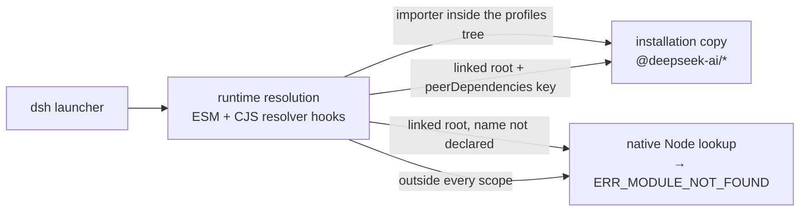
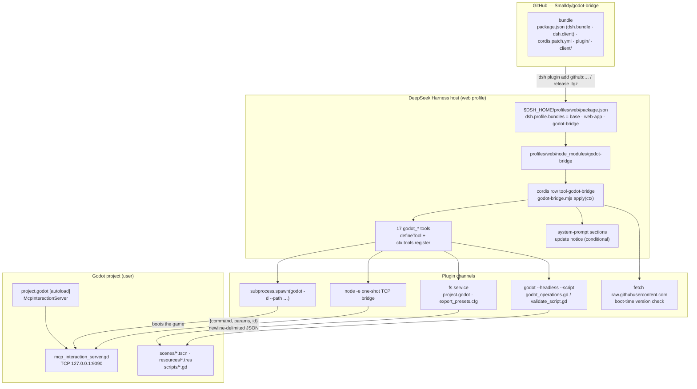
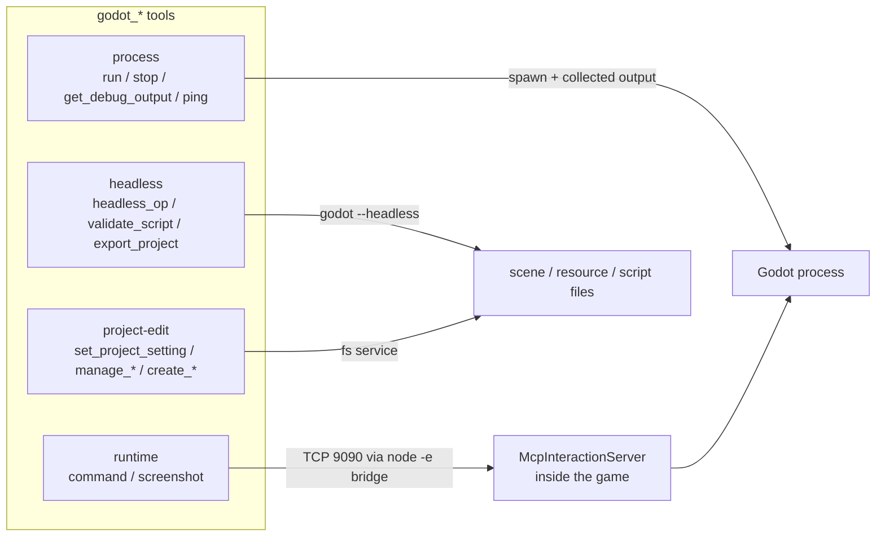
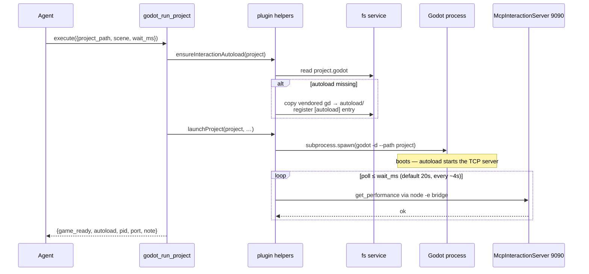
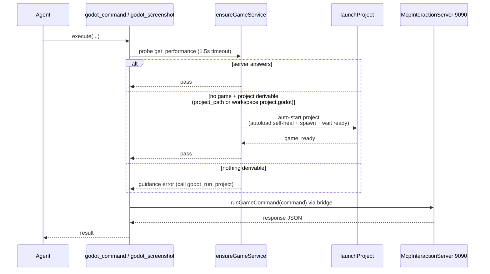

[English](ARCHITECTURE.md) | [中文](ARCHITECTURE.zh-CN.md)

# godot-bridge — architecture

## Why this exists

[godot-mcp](https://github.com/tugcantopaloglu/godot-mcp) is an MCP server (stdio JSON-RPC) wrapping three layers of real work:

1. **Process management** — `spawn(godot -d --path <project>)`, collect output, kill on demand.
2. **Runtime game control** — connect to the game's `McpInteractionServer` autoload on **TCP 127.0.0.1:9090** with newline-delimited JSON `{command, params, id}`; ~105 `game_*` tools map onto these commands.
3. **Headless static operations** — `godot --headless --path <project> --script godot_operations.gd <op> <json>` (scene edits, script validation, project creation).

The MCP layer itself contributes nothing but an outer JSON-RPC shell. DeepSeek Harness already has native equivalents for everything:

| layer | godot-mcp | godot-bridge |
| --- | --- | --- |
| process | Node `spawn` | host `subprocess.spawn` (same args) |
| runtime | TCP 9090 JSON | same TCP 9090 JSON via a one-shot `node -e` bridge |
| headless | `godot --headless …` | included: `godot_headless_op` + `godot_validate_script` over vendored `godot_operations.gd` / `validate_script.gd` |

Crucially, **the game side does not know MCP exists**: `mcp_interaction_server.gd` is a plain TCP JSON server. Replacing the MCP server requires zero game-side changes; `project.godot` autoloads stay as-is.

## The TCP bridge

The dynamic sandbox and the preset environment expose no raw `net` socket to plugin code, so each command spawns a short-lived `node -e` bridge:

```
node -e "<bridge>" <command> <paramsJson>
```

The bridge connects to 127.0.0.1:9090, writes one `{command, params, id:1}\n`, prints the first complete response line, and exits. The game server is single-connection with a `_busy` flag, so this connection-per-command model is a perfect match. `argv[1]`/`argv[2]` carry the command and params (`node -e` puts extra args at index 1+).

## Sandbox interaction (the important one)

DSH's file sandbox (`workspace-write`) restricts writes to the workspace + temp areas. The **shell executor** (pwsh/bash tools) applies that policy to the whole process tree (Windows restricted-token runner), so launching Godot from a shell tool crashes it: Godot writes `user://` (= `%APPDATA%\Godot\app_userdata\<project>\`, startup logs) and dies with `Failed to open 'user://logs/…'` → signal 11.

godot-bridge spawns through the harness's **raw `subprocess` service** — the unconfined primitive the shell executor itself uses internally — so Godot runs normally. Do not launch the game through pwsh/bash tools in a sandboxed session; use `godot_run_project`.

## Tool model

All tools return the game's response JSON verbatim (canonical value validated against `{type:'object', additionalProperties:true}`), rendered as text. Tool calls are exclusive by default (no `isConcurrencySafe`), matching the single-command game server.

## The task center (the second component row)

The same package mounts a second Loader row through `cordis.patch.yml`:

```yaml
- insert:
    - id: tool-godot-bridge
      name: godot-bridge
    - id: task-center
      name: godot-bridge/task-center   # exports["./task-center"]
```

A bundle is one Plugins-page card and a row is one component, so the task center is a component of this plugin, not a separate package to install. The browser half cannot be split the same way — a package resolves exactly one `./client` bundle — so `client/client.js` carries both the engine-path form and the task-center panel.

The action vocabulary lives in `actions/registry.mjs`; handlers are in `actions/` and `kernel/`, composed by `api.mjs`. The tool and the panel are two bindings of the same state (`state.mjs`) and the same model (`service.mjs`), so they cannot drift into two rule sets. The module map is in [docs/refactor/ARCHITECTURE.md](docs/refactor/ARCHITECTURE.md).

### Board

- **One JSON file per project**: `<project>/.agents/tasks.json`, schema v2. It is working state, not source: it is expected to be gitignored and stays readable after the plugin is uninstalled.
- Every read validates and normalises: a future version is refused rather than downgraded; duplicate or malformed ids are refused; a v1 board migrates on read (its old statuses collapse into the current vocabulary, `blockedBy` becomes `dependsOn`, and a stale claim is released because the process that held it is gone).
- Concurrency is three layers: an in-process promise chain per path, `replaceIfVersion` (FsVersion CAS) across processes, and on `FS_STALE_VERSION` a re-read that re-applies the mutation (not its previous result), up to three attempts.
- Writes use a sandbox policy rooted at the project directory, so a board outside the session workspace is still writable.
- `<project>/.agents/roles.json` holds the role profiles (see **Roles**) and `<project>/.agents/test-harness.json` the machine-local harness paths (see the README). Both are optional project-local runtime files.

### Phase machine

A task walks exactly one machine: `pending → running → reviewing → testing → done`, with `blocked` and `cancelled` as exits. Readiness is still derived, never stored.

| status | meaning |
| --- | --- |
| `pending` | not dispatched. Readiness comes from `dependsOn`: **ready** (every prerequisite done and merged), **waiting** (a prerequisite is not done yet), **broken** (a prerequisite is missing or cancelled and needs a human). |
| `running` | claimed by a worker, with a 60-minute lease that any assignee activity renews. `submit` leaves this phase. |
| `reviewing` | submitted and waiting for the reviewer's verdict; the record carries the round, the actor, the diff and the reasons of a previous round. |
| `testing` | review approved; an independent candidate exists and the tester owes a verdict. The record carries the round, the actor and the evidence. |
| `done` | merged into the target (or manually completed by the user/merger). Dependents are released only now. |
| `blocked` | needs a human: a manual block, a dead worker, an exhausted attempt budget, three review rounds, or a review/test timeout. |
| `cancelled` | abandoned. |

`reopen` returns a closed task to `pending` and clears its lease; `retry` re-queues a blocked one. The board keeps every phase record — `review`, `test` and `merge` — so a reopened task still explains what happened before.

### Review

- `submit` commits the task worktree, opens a merge request (base = current target head, head = the new commit, changed files = the base..head diff) and moves the task to REVIEW in the same write.
- The host provisions the reviewer role and sends it a **self-contained per-round brief**: what the task asked for (spec/acceptance), the tree under review (base..head, declared vs actual files), the worker evidence, the project conventions and a review checklist. The reviewer is a read-only, independent context.
- `approveReview` (reviewer, or the user) moves the task to TESTING; `requestChanges` (with concrete reasons) returns it to RUNNING and sends the worker a rework brief that points at the same worktree and context. A worker can never review its own task.
- The review round counter caps at **3**. A review that stays undecided past 10 minutes is reminded once and, if it is still undecided a full timeout later, the task is blocked for triage (owner and Lead are told). The sweep is driven by the host tick, so it works with dispatch paused.

### Test and the candidate

- `approveReview` builds the candidate **before** the phase moves: a throwaway checkout `<project>/.worktrees/test-<id>` on branch `test/<id>`, created from the current target head and merged with the task branch (`--no-ff`). A conflict or an unmergeable branch is a readable `candidate-conflict` / `candidate-failed` refusal and the task stays in REVIEW for a changes request — nothing is half-transitioned.
- On success the task enters TESTING with the candidate recorded (path, branch, base, head) and the tester receives a self-contained brief: acceptance criteria, the candidate path and branch, the runbook (how to verify in that tree) and the evidence format. The tester is read-only on implementation and may launch the candidate's Godot project through the `godot_*` tools.
- `passTest` records the verdict and hands the accepted candidate to the merge queue (see below). `failTest` records the evidence, discards the candidate and returns the task to RUNNING so the worker fixes it in the same worktree.
- A test round that stays undecided is reminded at 10 minutes and blocked at 20, recording the tester, the elapsed time and the candidate state.

### Merge queue and auto-merge

- One **serialised** merge queue owns every integration. A five-second host sweep enqueues every task that is in TESTING with a passed test and an open request; the same path serves the manual `mergeRequest`. Nothing merges outside that queue.
- Merging is **idempotent**: the queue holds one in-flight merge per task, refuses a task whose request is already merged, re-reads the board inside the queue turn, and refuses to rebuild a candidate for a task that is no longer testing. A duplicated sweep, a duplicated request or a host restart cannot double-merge.
- The accepted candidate is integrated in a throwaway `merge-<id>` worktree. The merge only proceeds while the target still points at the base the candidate was built from; a moved target invalidates the verdict — the old candidate is discarded, a new one is built from the current head, the test round restarts and the tester is asked to retest. A conflict is recorded readably and the target branch is never touched.
- A merged task turns DONE, its task worktree and test candidate are removed, and dependents are released. `mergeRequest` / `rejectMerge` / `refreshMerge` stay available to the user or the `merger` teammate for manual integration, audit or repair; no other agent may merge.

### Timeouts and the host watchdog

- **Review**: reminder after 10 minutes, block after another full timeout.
- **Test**: reminder at 10 minutes, block at 20.
- **Round cap**: three review rounds without approval block the task.
- **Host actions**: every async host action (candidate build, candidate merge, merge request, role provisioning, notification) is bounded at **2 minutes**. A stuck action answers `queue-timeout` / `action-timeout`, and the deadline also guards the write: an abandoned unit that settles late can no longer record anything.
- All of these are driven by the host tick, never by a model action, so a silent agent cannot strand a task.

### Dependencies and dispatch

- `B.dependsOn = [A]` means A must be `done` (and merged, when it has a merge request) before B is dispatched. The graph is validated on write (no self-dependency, no unknown or cancelled prerequisite, no cycle); deleting a task another live task depends on is refused unless forced.
- Dispatch is project-level: `start` / `pause` is persisted in `board.dispatch`. A pass reaps claims left by a previous host process, then settles lapsed leases by **liveness** even while dispatch is paused, then hands ready tasks to workers while fewer than `maxConcurrent` tasks are running.
- Ready tasks are ordered `priority` descending, then `createdAt` ascending, then id.
- Every dispatch **claims the task before anything leaves the process**: the claim is the mutex and only `claimTask` produces `running`. It then calls `sendMessage` to an idle teammate, or `spawnTeammate` for a new one. The attempt counter increments exactly at claim; after the attempt budget (default 3) the task becomes `blocked` instead of retrying forever.
- Passes are serialised (never overlapping) and triggered by `start`, every board write, `agent/status` events, and a five-second timer.

### Leases and liveness

- A running task holds a **60-minute lease**. Every `task_center` call by the assignee renews it **unconditionally** — there is no "half spent" gate — and a host heartbeat in every pass renews it on a fixed five-minute cadence, so a long tool run cannot lose its claim.
- A lapsed lease is judged by **liveness**, not by the clock: while the assignee session still exists the host extends the lease (bounded by a four-hour per-attempt hard cap) and records a `lease-extended` event — **a live holder is never replaced**. When the session is gone or failed, or the cap is reached, the task is handed over: the old agent is interrupted, the task returns to `pending` (or `blocked` once the budget is gone), and the next attempt **adopts the previous attempt's worktree and branch** when it left a commit instead of restarting from the target.
- One task has at most one live agent: a requeued task is not dispatched while its previous holder is still alive (only a liveness-capped handover may proceed, because that holder was told to stop).
- The board exposes `leaseRemaining` / `leaseReminder` and records `lease-handover` / `attempt-adopt` events. A host restart reaps its claims on the next pass.
- WorkAgents are Agent Teams **teammates under the one resolved Team Lead**. The scheduler reuses an idle teammate (`status: inactive`) first and only spawns when none is idle, within `maxWorkAgents`.

### Worktree creation and robustness

- A task checkout lives at `<project>/.worktrees/<taskId>-<attempt>` on branch `task/<taskId>-<attempt>`. The execution model requires it: dispatch refuses to start when the project cannot host a worktree, and a claim-time failure releases the task's locks, pauses dispatch and records why.
- Every `git worktree add` has its **own 180-second timeout** instead of sharing the general git/subprocess budget. A timeout or a failed add **rolls back** everything it may have registered — the worktree entry, the half-created branch, the lock file and the pruned metadata — then retries **once**.
- Creation is **serialised per repository**, so two tasks (or a task and a candidate build) cannot race the same worktree metadata. If the retry also fails, the failure is reported readably instead of leaving a half-registered checkout that would break every later dispatch.

### Roles

- Three fixed kinds, each owning one workflow stage: `worker` → `implement`, `reviewer` → `review`, `tester` → `test`. A role instance is a real Agent Teams teammate slot (`worker-1`, `reviewer-2`, …) under the resolved Lead; the host provisions a missing stage role and replaces a dead or timed-out one (a five-minute provisioning timeout).
- Profiles live in `<project>/.agents/roles.json` (version 1). The built-in `worker` / `reviewer` / `tester` profiles always exist; custom profiles add a name, one of the three kinds, the kind's stage, 1–8 instances, allowed permissions (`read-only`, `implement`, `review`, `test`, `merge`, `admin`), a `fresh` or `fork` context, the skills to load and a prompt template. Stage bindings map each stage to a profile that owns it; a malformed or stale binding falls back to the kind's own profile.
- A profile prompt is a **template**: it may inject `{{TASK_ID}}`, `{{TASK_TITLE}}`, `{{SPEC}}`, `{{COMPLETIONS_DEF}}`, `{{GIT_INFO}}`, `{{PROJECT}}`, `{{LEAD}}`, `{{ROLE}}` and `{{STAGE}}`. `validateRoleProfile` refuses any other `{{NAME}}` with `invalid-role-variable` and the allowed list; an empty template is legal. The brief composes, in order: the host header (role, stage, project, Lead, permissions, fork note) → the rendered template → the task data → the host-fixed duties / permission boundary / verdict schema → the skills injection. A template can add to the brief but never rewrite the fixed parts.
- Reviewer and tester are read-only independent contexts (their brief says so and their verdict schema is the only task action they may call); a worker must never review or test its own task. The verdict gate lives in the API: only a reviewer (or the user) may `approveReview` / `requestChanges`, only a tester (or the user) may `passTest` / `failTest`.
- Role administration is **user-only**: `rolesList` / `rolesCreate` / `rolesUpdate` / `rolesDelete` / `rolesBind` / `rolesDrain` / `rolesReplace` / `rolesReset` and the read-only `skillsCatalog` are hidden from the tool enum and refused for agents. `rolesDrain` stops scheduling an instance and `rolesReplace` waits for it to go idle before spawning its replacement, reporting `waited` / `timedOut` / `drained` / `created` / `replaced` / `reused`.

### Settings

- The GUI exposes one number: **maximum concurrency** (`maxConcurrent`, 1–8; default 3). Setting it derives the rest — the WorkAgent cap becomes concurrency + 1 (clamped to 1–12; default 4), spawning is enabled, and the retry budget is set to 3 — so the user does not have to reason about several capacity knobs.
- The advanced `settings` action (user-only) can still set `maxWorkAgents`, `allowSpawn` and `maxAttempts` explicitly; the GUI does not expose those fields.

### Consent

- When an **agent** calls `start`, it does not start the scheduler: the call writes `dispatch.request` and returns `needs-consent`, asking the user to approve it.
- The panel shows the request as a banner. Only the user's `approveStart` runs dispatch and clears the request in the same write; `rejectStart` (or the agent's `cancelStartRequest`) clears the request without starting anything.
- `approveStart`, `rejectStart`, `settings` and every role action are user-only: the tool enum omits them and the API refuses them for an agent even if called directly. `pause` is immediate for either side.

### File locks

- A task declares what it will write with `writeFiles`. Paths canonicalise to project-relative POSIX paths, are de-duplicated, and are validated against the project root, so a lock cannot be conjured for a path outside the project.
- Locks live in host memory, keyed by canonical path and owned by the task id. There is no wait queue: a task whose files conflict is skipped on that pass and retried on the next, and the conflict names the holder.
- Before dispatch the scheduler acquires **all** of the task's declared paths or none of them (atomic), re-checking after it has chosen a worker. A directory lock conflicts with every path under it, segment-aware (`scripts/core` does not conflict with `scripts/core2`).
- A task's locks are released when it reaches `done`, `blocked` or `cancelled`, and when its lease is handed over; a failed dispatch and a host-restart reap release them too. An agent may `lock` extra files for its running task; those carry the same task id and are released with it.
- Lock leases are also 60 minutes, renewed by the same heartbeat (and host tick) that renews the task.

### Branch protection

The task center is the only way work reaches the protected target branch (`feat/task-center-v2`). `scripts/check-target-history.mjs` (`npm run check:target`, also part of `npm run check`) walks the target history and explains every **non-merge** commit by one of three sources:

1. a merge of a `task/<id>-<n>`, `test/<id>` or `merge/<id>` branch — the commit arrived on the side of that merge;
2. a task in `<project>/.agents/tasks.json` that is `done` **and** merged, whose recorded commit (or merge head) is that commit;
3. an **emergency exception** declared in the script (`EMERGENCY_EXCEPTIONS`), which must name the reason and the task cards that retro-cover it.

Anything else is reported with its hash and subject and the check exits non-zero. History before the recorded `LEGACY_UP_TO` commit predates the policy — it is reported as skipped, never rewritten, and the guard protects every commit after it. A missing target ref (shallow CI checkout) is reported and skipped instead of failing.

**Emergency hotfix process.** An out-of-band fix may reach the target with `TASK_CENTER_MERGE=1`; doing so requires all three of: a retro task card covering the fix (with a regression test), a CHANGELOG entry naming the commits, and an `EMERGENCY_EXCEPTIONS` entry with the reason and card ids. The two merge-queue hotfixes are recorded that way: `1695506` (the merge) and `2c895b4` (the fix — idempotent candidate merging and bounded git subprocesses), covered retroactively by T-30's regression tests and the bounded host-action path the watchdog enforces.

**Local hook.** `node scripts/setup-hooks.mjs` writes `.githooks/pre-commit` and sets `core.hooksPath=.githooks`, so a direct commit on the target is refused with a pointer at the task center; `TASK_CENTER_MERGE=1` is the explicit bypass, and a detached HEAD is not attributed to the target. The hook only reads the current branch, so it never interferes with task branches or with the host's merge flow.

**Known limitations.** The guard recognises merge subjects of the `Merge branch '<branch>' ...` and `Merge <branch>: ...` form the task center writes; a hosting-provider wording (for example `Merge pull request #N from ...`) would not identify the side branch, so such a merge shows up as untraceable commits and needs an exception until the parser learns the wording. A missing target ref (shallow CI checkout) is reported and skipped rather than failed, so a CI job should keep or fetch the target ref and treat a skip as a signal that protection was not exercised. `npm run hooks:install` writes `.githooks/` inside the repository while that directory stays untracked by design: add it to `.gitignore`, or commit it if the team wants the hook shared.

### Isolated DSH harness

The tester (or the user) can drive a disposable DSH instance through `harnessStart` / `harnessStatus` / `harnessSmoke` / `harnessRestart` / `harnessStop`. It gets its own `DSH_HOME`, profile, free port and project copy, installs the candidate plugin there and proves the page, health, plugin row and task-center routes answer — never touching the production profile, session or port. A version mismatch (or an unverifiable version) fails the smoke; an unreachable instance reports `health-timeout` with the last health state and log tail. Configuration and the real smoke transcript are in the README.

### Boundaries

- **One project at a time.** The shared state keeps a single project hint; the scheduler follows the board that was last touched, and switching projects goes through `openProject` (which verifies the directory). Parallel dispatch across several projects is not implemented.
- **One Team / Lead at a time.** Dispatch resolves the first live Team Lead and hands work only to that team's WorkAgents. There is no per-project team and no multi-team fan-out; without the Agent Teams services, tasks stay `pending` with an explicit `no-lead` / `no-team-service` reason instead of failing the plugin.
- The board and the panel do not depend on a Team; only actual dispatch does.
- **No session-jump API.** The status view can copy a session id, but opening that session remains a manual step in the Team list.
- **Godot launch channel.** A role that needs the game (typically the tester) must use the `godot_*` tools; launching Godot through a shell tool crashes it under the file sandbox (see above).
- **A moved target invalidates a verdict by design.** The host rebuilds the candidate and restarts the test round rather than merging a tree that no longer matches what was tested.

## Dependency contract and runtime resolution

A DSH plugin that imports harness packages (`@deepseek-ai/dsh-tools`, `@deepseek-ai/schemastery`, …) never resolves them from the npm registry. The launcher computes one immutable **runtime resolution** — the dependency closure of the installation plus the selected bundles — and installs it into Node's ESM and CommonJS resolvers (DSH 0.2 does this in-process, replacing the 0.1.x physical module-fallback layer; the old `.dsh-module-fallback` directories are only cleaned up). Which modules get that routing is decided per importing path:

- **Inside the profiles tree** (`$DSH_HOME/profiles/<name>/…`): a profile-layer importer is routed to the installation's copy for any `@deepseek-ai/*` package the installation carries. A bundle installed with `dsh plugin add` lives here, so it needs no declaration.
- **Linked root** (a symlink under a profile's `node_modules` whose target lies outside the profiles tree — what a `link:` dependency produces): routed only for package names the importing package declares in its own `peerDependencies`. The resolver reads `peerDependencies` keys, not `dependencies`, and Node's ESM loader resolves symlinks before importing, so the importer path really is the target outside the tree.
- **Anything else** (a path outside both, e.g. a file copied into an agent preset): no routing at all — plain Node lookup, which cannot see the installation's packages.

Two consequences shape this package's manifest:

- `peerDependencies` is a **load-time contract**, not just metadata: without the declaration a `link:` install fails the whole bundle import (`ERR_MODULE_NOT_FOUND: Cannot find package '@deepseek-ai/dsh-tools'`) and none of the seventeen tools registers — the 0.1.7-and-earlier behaviour on DSH 0.2.
- DSH also **gates** declared `@deepseek-ai/dsh` / `@deepseek-ai/dsh-*` peers against the runtime version (prereleases participate in the range match). A range that does not match makes the launcher skip the bundle with an explicit message; a missing peer imposes no constraint and therefore can never cause a skip. That is why the declaration is a range (`>=0.1.6-0`) rather than a pin, and why `peerDependenciesMeta.optional` marks the harness packages: pnpm must never fetch them from the registry.

The **browser half** is a different contract and deliberately declares nothing here. `dsh.client` makes the host serve `exports["./client"]` as a classic script to the web client, and that script's factory resolves its imports against the client's own platform module table (React and a few static libraries) instead of Node — so no `peerDependencies` entry participates. It exists for one reason: the Plugins page renders a configuration section only for a bundle whose browser half registers one of its slots, and this half registers `plugins.bundle.config` under the package name, which is what puts the `Godot engine path` field on the `godot-bridge` card's page. Its writes take the client settings road (`configForms` scope → the settings service → `configEditor.edit`), i.e. the same profile patch the `godot_set_engine_path` tool writes.



`npm run check` enforces the declaration statically; `scripts/diagnose-dsh-resolution.mjs` prints what a running launcher actually routes.

## Architecture diagrams

### System overview



### Tool channels



### godot_run_project — launch flow



### Runtime tool pre-flight (self-healing guard)



## Known behavior notes

- `eval` compile errors pause a debug-mode game at the debugger (identical to godot-mcp). Recover with `godot_stop_project` + `godot_run_project`; write dynamic-access code (`node.get("prop")`) to dodge static typing.
- `godot_get_debug_output` is incremental (offset-based readers).
- The configured Godot path must be the real exe; a version-manager shim exits immediately and orphans the real process.
