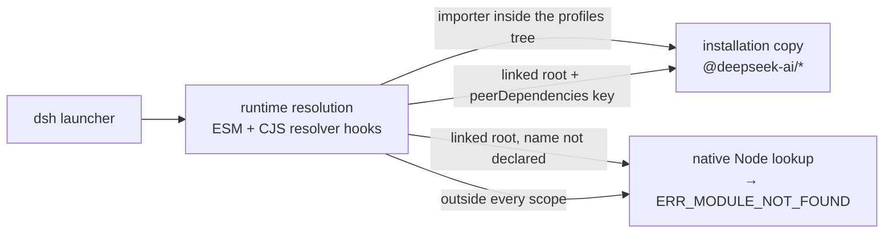
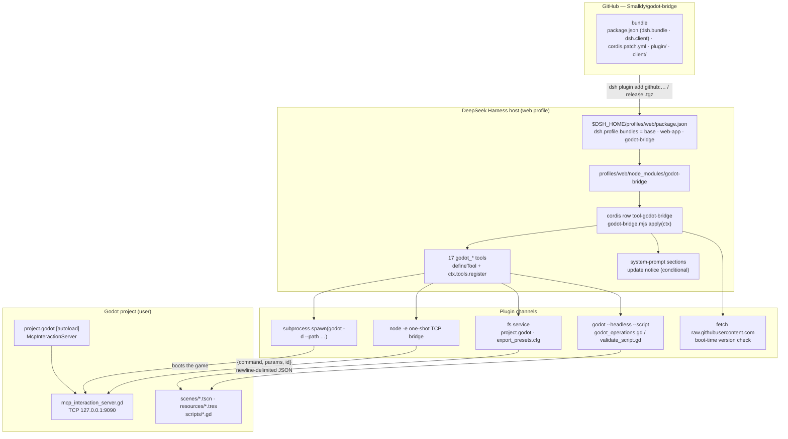
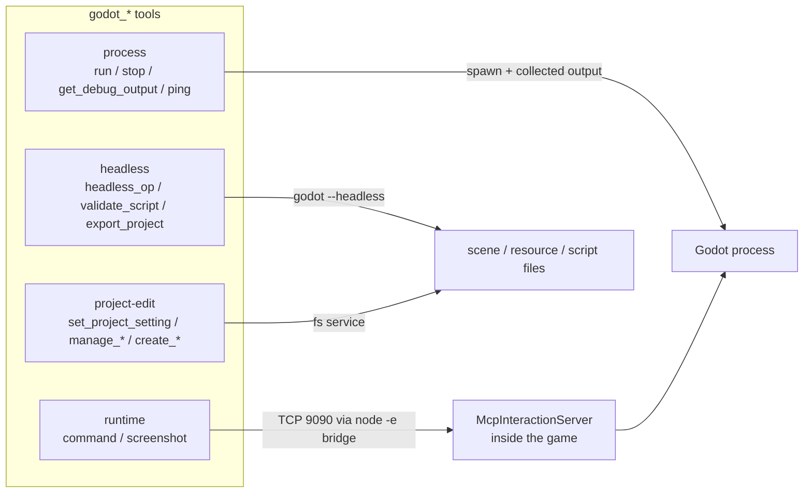
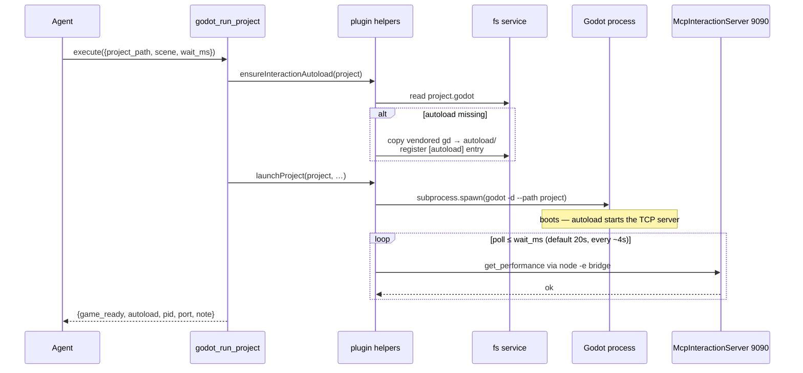
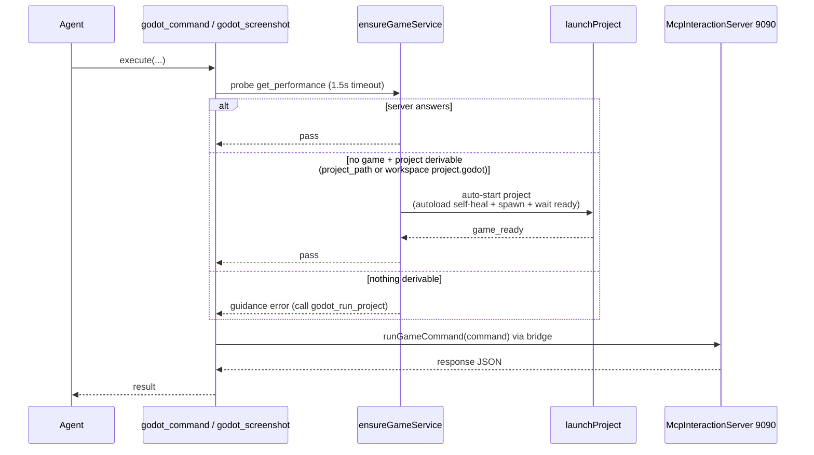

[English](ARCHITECTURE.md) | [中文](ARCHITECTURE.zh-CN.md)

# godot-bridge — architecture

## Why this exists

[godot-mcp](https://github.com/tugcantopaloglu/godot-mcp) is an MCP server (stdio JSON-RPC) wrapping three layers of real work:

1. **Process management** — `spawn(godot -d --path <project>)`, collect output, kill on demand.
2. **Runtime game control** — connect to the game's `McpInteractionServer` autoload on **TCP 127.0.0.1:9090** with newline-delimited JSON `{command, params, id}`; ~105 `game_*` tools map onto these commands.
3. **Headless static operations** — `godot --headless --path <project> --script godot_operations.gd <op> <json>` (scene edits, script validation, project creation).

The MCP layer itself contributes nothing but an outer JSON-RPC shell. DeepSeek Harness already has native equivalents for everything:

| layer | godot-mcp | godot-bridge |
| --- | --- | --- |
| process | Node `spawn` | host `subprocess.spawn` (same args) |
| runtime | TCP 9090 JSON | same TCP 9090 JSON via a one-shot `node -e` bridge |
| headless | `godot --headless …` | included: `godot_headless_op` + `godot_validate_script` over vendored `godot_operations.gd` / `validate_script.gd` |

Crucially, **the game side does not know MCP exists**: `mcp_interaction_server.gd` is a plain TCP JSON server. Replacing the MCP server requires zero game-side changes; `project.godot` autoloads stay as-is.

## The TCP bridge

The dynamic sandbox and the preset environment expose no raw `net` socket to plugin code, so each command spawns a short-lived `node -e` bridge:

```
node -e "<bridge>" <command> <paramsJson>
```

The bridge connects to 127.0.0.1:9090, writes one `{command, params, id:1}\n`, prints the first complete response line, and exits. The game server is single-connection with a `_busy` flag, so this connection-per-command model is a perfect match. `argv[1]`/`argv[2]` carry the command and params (`node -e` puts extra args at index 1+).

## Sandbox interaction (the important one)

DSH's file sandbox (`workspace-write`) restricts writes to the workspace + temp areas. The **shell executor** (pwsh/bash tools) applies that policy to the whole process tree (Windows restricted-token runner), so launching Godot from a shell tool crashes it: Godot writes `user://` (= `%APPDATA%\Godot\app_userdata\<project>\`, startup logs) and dies with `Failed to open 'user://logs/…'` → signal 11.

godot-bridge spawns through the harness's **raw `subprocess` service** — the unconfined primitive the shell executor itself uses internally — so Godot runs normally. Do not launch the game through pwsh/bash tools in a sandboxed session; use `godot_run_project`.

## Tool model

All tools return the game's response JSON verbatim (canonical value validated against `{type:'object', additionalProperties:true}`), rendered as text. Tool calls are exclusive by default (no `isConcurrencySafe`), matching the single-command game server.

## The task center (the second component row)

The same package mounts a second Loader row through `cordis.patch.yml`:

```yaml
- insert:
    - id: tool-godot-bridge
      name: godot-bridge
    - id: task-center
      name: godot-bridge/task-center   # exports["./task-center"]
```

A bundle is one Plugins-page card and a row is one component, so the task center is a component of this plugin, not a separate package to install. The browser half cannot be split the same way — a package resolves exactly one `./client` bundle — so `client/client.js` carries both the engine-path form and the task-center panel.

One action registry (`api.mjs`) is the single vocabulary behind the `task_center` tool and `POST /godot-bridge/task-center/action`; the tool and the panel are two bindings of the same state (`state.mjs`) and the same model (`service.mjs`), so they cannot drift into two rule sets.

### Board

- **One JSON file per project**: `<project>/.agents/tasks.json`, schema v2. It is working state, not source: it is expected to be gitignored and stays readable after the plugin is uninstalled.
- Every read validates and normalises: a future version is refused rather than downgraded; duplicate or malformed ids are refused; a v1 board migrates on read (old statuses collapse into the five, `blockedBy` becomes `dependsOn`, a stale claim is released because the process that held it is gone).
- Concurrency is three layers: an in-process promise chain per path, `replaceIfVersion` (FsVersion CAS) across processes, and on `FS_STALE_VERSION` a re-read that re-applies the mutation (not its previous result), up to three attempts.
- Writes use a sandbox policy rooted at the project directory, so a board outside the session workspace is still writable.

### Statuses

The stored vocabulary is exactly five; the board columns are laid out from them:

| status | meaning |
| --- | --- |
| `pending` | not dispatched. Readiness is derived from `dependsOn`, never stored: **ready** (all prerequisites done), **waiting** (a prerequisite is not done yet), **broken** (a prerequisite is missing or cancelled and needs a human). |
| `running` | claimed by a worker, with a 60-minute lease that any assignee activity renews. |
| `done` | finished. **There is no review or acceptance state: `submit` is completion**, and dependents are released immediately. |
| `blocked` | needs a human: a manual block, a dead worker, or an exhausted attempt budget. |
| `cancelled` | abandoned. |

The panel renders five columns from these: ready, waiting (both `pending`), running, done, and a closed column that holds `blocked` and `cancelled`.

### Dependencies and dispatch

- `B.dependsOn = [A]` means A must be `done` before B is dispatched. The graph is validated on write (no self-dependency, no unknown or cancelled prerequisite, no cycle); deleting a task another live task depends on is refused unless forced.
- Dispatch is project-level: `start` / `pause` is persisted in `board.dispatch`. A pass reaps claims left by a previous host process, then settles lapsed leases by **liveness** (extend while the holder is alive, hand over when it is gone) even while dispatch is paused, and finally hands ready tasks to workers while fewer than `maxConcurrent` tasks are running.
- Ready tasks are ordered `priority` descending, then `createdAt` ascending, then id.
- Every dispatch **claims the task before anything leaves the process**: the claim is the mutex and only `claimTask` produces `running`. It then calls `sendMessage` to an idle teammate, or `spawnTeammate` for a new one. The attempt counter increments exactly at claim; after the attempt budget (default 3) the task becomes `blocked` instead of retrying forever.
- A running task holds a **60-minute lease**. Every `task_center` call by the assignee renews it **unconditionally** (there is no "half spent" gate) and a host heartbeat in every pass renews it on a fixed five-minute cadence, so a long tool run cannot lose its claim.
- A lapsed lease is judged by **liveness**, not by the clock: while the assignee session still exists the host extends the lease (bounded by a four-hour per-attempt hard cap) and records a `lease-extended` event — **a live holder is never replaced**. When the session is gone or failed, or the cap is reached, the task is handed over: the old agent is interrupted, the task returns to `pending` (or `blocked` once the budget is gone), and the next attempt **adopts the previous attempt's worktree and branch** when it left a commit instead of restarting from the target. A host restart reaps its claims on the next pass.
- One task has at most one live agent: a requeued task is not dispatched while its previous holder is still alive (only a liveness-capped handover may proceed, because that holder was told to stop).
- WorkAgents are Agent Teams **teammates under the one resolved Team Lead**. The scheduler reuses an idle teammate (`status: inactive`) first and only spawns when none is idle, within `maxWorkAgents`.
- Passes are serialised (never overlapping) and are triggered by `start`, every board write, `agent/status` events, and a five-second timer.

### Consent

- When an **agent** calls `start`, it does not start the scheduler: the call writes `dispatch.request` and returns `needs-consent`, asking the user to approve it.
- The panel shows the request as a banner. Only the user's `approveStart` runs dispatch and clears the request in the same write; `rejectStart` (or the agent's `cancelStartRequest`) clears the request without starting anything.
- `approveStart`, `rejectStart` and `settings` are user-only: the tool enum omits them and the API refuses them for an agent even if called directly. `pause` is immediate for either side.

### Settings

- The GUI exposes one number: **maximum concurrency** (`maxConcurrent`, 1–8; default 3). Setting it derives the rest — the WorkAgent cap becomes concurrency + 1 (clamped to 1–12; default 4), spawning is enabled, and the retry budget is set to 3 — so the user does not have to reason about several capacity knobs.
- The advanced `settings` action (user-only) can still set `maxWorkAgents`, `allowSpawn` and `maxAttempts` explicitly; the GUI does not expose those fields.

### File locks

- A task declares what it will write with `writeFiles`. Paths canonicalise to project-relative POSIX paths, are de-duplicated, and are validated against the project root, so a lock cannot be conjured for a path outside the project.
- Locks live in host memory, keyed by canonical path and owned by the task id. There is no wait queue: a task whose files conflict is skipped on that pass and retried on the next, and the conflict names the holder.
- Before dispatch the scheduler acquires **all** of the task's declared paths or none of them (atomic), re-checking after it has chosen a worker. A directory lock conflicts with every path under it, segment-aware (`scripts/core` does not conflict with `scripts/core2`).
- A task's locks are released when it reaches `done`, `blocked` or `cancelled`, and when its lease is handed over; a failed dispatch and a host-restart reap release them too. An agent may `lock` extra files for its running task; those carry the same task id and are released with it.
- Lock leases are also 60 minutes, renewed by the same heartbeat (and host tick) that renews the task.

### Branch protection

The task center is the only way work reaches the protected target branch (`feat/task-center-v2`). `scripts/check-target-history.mjs` (`npm run check:target`, also part of `npm run check`) walks the target history and explains every **non-merge** commit by one of three sources:

1. a merge of a `task/<id>-<n>`, `test/<id>` or `merge/<id>` branch — the commit arrived on the side of that merge;
2. a task in `<project>/.agents/tasks.json` that is `done` **and** merged, whose recorded commit (or merge head) is that commit;
3. an **emergency exception** declared in the script (`EMERGENCY_EXCEPTIONS`), which must name the reason and the task cards that retro-cover it.

Anything else is reported with its hash and subject and the check exits non-zero. History before the recorded `LEGACY_UP_TO` commit predates the policy — it is reported as skipped, never rewritten, and the guard protects every commit after it. A missing target ref (shallow CI checkout) is reported and skipped instead of failing.

**Emergency hotfix process.** An out-of-band fix may reach the target with `TASK_CENTER_MERGE=1`; doing so requires all three of: a retro task card covering the fix (with a regression test), a CHANGELOG entry naming the commits, and an `EMERGENCY_EXCEPTIONS` entry with the reason and card ids. The two merge-queue hotfixes are recorded that way: `1695506` (the merge) and `2c895b4` (the fix — idempotent candidate merging and bounded git subprocesses), covered retroactively by T-30's regression tests and the bounded-action work that T-38's lease/tick handling relies on.

**Local hook.** `node scripts/setup-hooks.mjs` writes `.githooks/pre-commit` and sets `core.hooksPath=.githooks`, so a direct commit on the target is refused with a pointer at the task center; `TASK_CENTER_MERGE=1` is the explicit bypass, and a detached HEAD is not attributed to the target. The hook only reads the current branch, so it never interferes with task branches or with the host's merge flow.

### Boundaries

- **One project at a time.** The shared state keeps a single project hint; the scheduler follows the board that was last touched, and switching projects goes through `openProject` (which verifies the directory). Parallel dispatch across several projects is not implemented.
- **One Team / Lead at a time.** Dispatch resolves the first live Team Lead and hands work only to that team's WorkAgents. There is no per-project team and no multi-team fan-out; without the Agent Teams services, tasks stay `pending` with an explicit `no-lead` / `no-team-service` reason instead of failing the plugin.
- The board and the panel do not depend on a Team; only actual dispatch does.

## Dependency contract and runtime resolution

A DSH plugin that imports harness packages (`@deepseek-ai/dsh-tools`, `@deepseek-ai/schemastery`, …) never resolves them from the npm registry. The launcher computes one immutable **runtime resolution** — the dependency closure of the installation plus the selected bundles — and installs it into Node's ESM and CommonJS resolvers (DSH 0.2 does this in-process, replacing the 0.1.x physical module-fallback layer; the old `.dsh-module-fallback` directories are only cleaned up). Which modules get that routing is decided per importing path:

- **Inside the profiles tree** (`$DSH_HOME/profiles/<name>/…`): a profile-layer importer is routed to the installation's copy for any `@deepseek-ai/*` package the installation carries. A bundle installed with `dsh plugin add` lives here, so it needs no declaration.
- **Linked root** (a symlink under a profile's `node_modules` whose target lies outside the profiles tree — what a `link:` dependency produces): routed only for package names the importing package declares in its own `peerDependencies`. The resolver reads `peerDependencies` keys, not `dependencies`, and Node's ESM loader resolves symlinks before importing, so the importer path really is the target outside the tree.
- **Anything else** (a path outside both, e.g. a file copied into an agent preset): no routing at all — plain Node lookup, which cannot see the installation's packages.

Two consequences shape this package's manifest:

- `peerDependencies` is a **load-time contract**, not just metadata: without the declaration a `link:` install fails the whole bundle import (`ERR_MODULE_NOT_FOUND: Cannot find package '@deepseek-ai/dsh-tools'`) and none of the seventeen tools registers — the 0.1.7-and-earlier behaviour on DSH 0.2.
- DSH also **gates** declared `@deepseek-ai/dsh` / `@deepseek-ai/dsh-*` peers against the runtime version (prereleases participate in the range match). A range that does not match makes the launcher skip the bundle with an explicit message; a missing peer imposes no constraint and therefore can never cause a skip. That is why the declaration is a range (`>=0.1.6-0`) rather than a pin, and why `peerDependenciesMeta.optional` marks the harness packages: pnpm must never fetch them from the registry.

The **browser half** is a different contract and deliberately declares nothing here. `dsh.client` makes the host serve `exports["./client"]` as a classic script to the web client, and that script's factory resolves its imports against the client's own platform module table (React and a few static libraries) instead of Node — so no `peerDependencies` entry participates. It exists for one reason: the Plugins page renders a configuration section only for a bundle whose browser half registers one of its slots, and this half registers `plugins.bundle.config` under the package name, which is what puts the `Godot engine path` field on the `godot-bridge` card's page. Its writes take the client settings road (`configForms` scope → the settings service → `configEditor.edit`), i.e. the same profile patch the `godot_set_engine_path` tool writes.



`npm run check` enforces the declaration statically; `scripts/diagnose-dsh-resolution.mjs` prints what a running launcher actually routes.

## Architecture diagrams

### System overview



### Tool channels



### godot_run_project — launch flow



### Runtime tool pre-flight (self-healing guard)



## Known behavior notes

- `eval` compile errors pause a debug-mode game at the debugger (identical to godot-mcp). Recover with `godot_stop_project` + `godot_run_project`; write dynamic-access code (`node.get("prop")`) to dodge static typing.
- `godot_get_debug_output` is incremental (offset-based readers).
- The configured Godot path must be the real exe; a version-manager shim exits immediately and orphans the real process.
