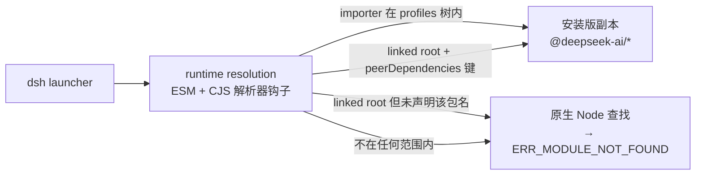
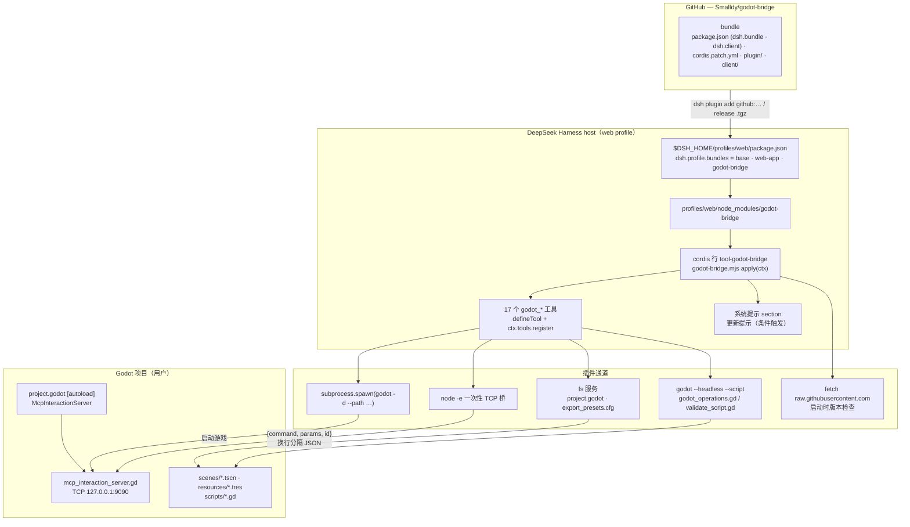
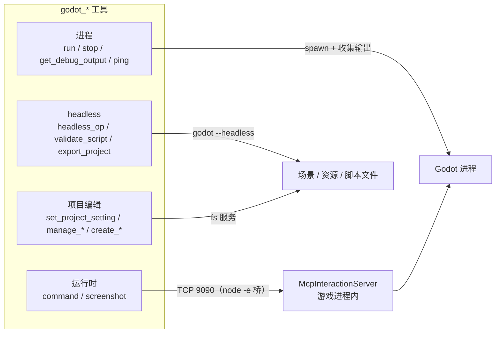
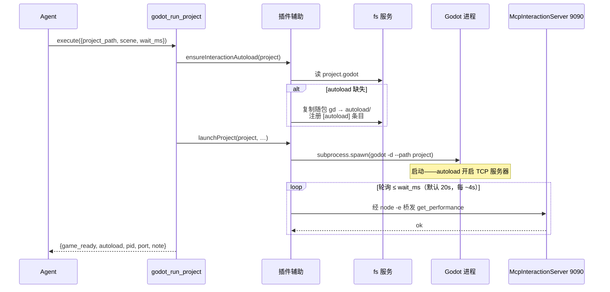
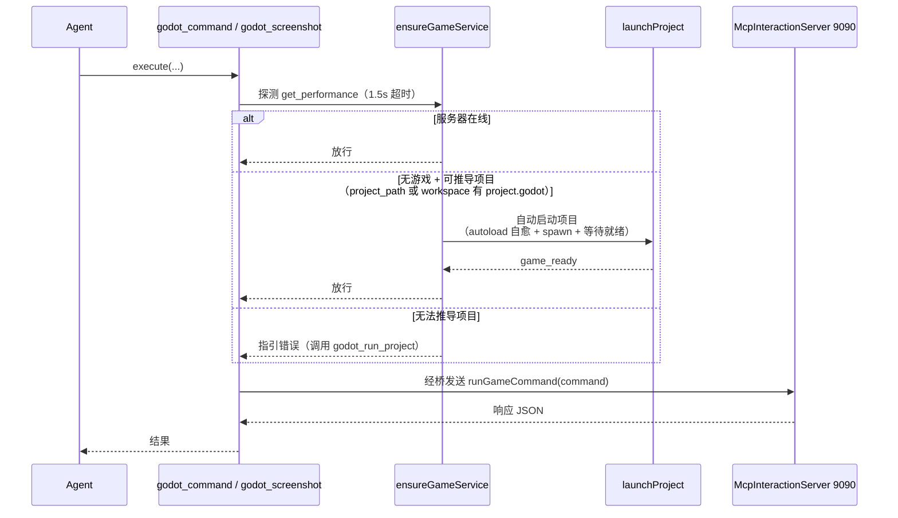

[English](ARCHITECTURE.md) | **中文**

# godot-bridge — 架构说明

## 为什么存在

[godot-mcp](https://github.com/tugcantopaloglu/godot-mcp) 是一个 MCP 服务器（stdio JSON-RPC），包了三层真正的活：

1. **进程管理** — `spawn(godot -d --path <project>)`、收集输出、按需杀掉。
2. **运行时游戏控制** — 连接游戏内 `McpInteractionServer` autoload 的 **TCP 127.0.0.1:9090**，用换行分隔 JSON `{command, params, id}` 通信；约 105 个 `game_*` 工具映射到这些命令。
3. **headless 静态操作** — `godot --headless --path <project> --script godot_operations.gd <op> <json>`（场景编辑、脚本校验、项目创建等）。

MCP 层本身除了一个外层 JSON-RPC 外壳外什么都没贡献。DeepSeek Harness 对每一层都有原生等价物：

| 层 | godot-mcp | godot-bridge |
| --- | --- | --- |
| 进程 | Node `spawn` | host `subprocess.spawn`（同样参数） |
| 运行时 | TCP 9090 JSON | 同一 TCP 9090 JSON，经一次性 `node -e` 桥 |
| headless | `godot --headless …` | 已实现：`godot_headless_op` + `godot_validate_script`，基于随包内置的 `godot_operations.gd` / `validate_script.gd` |

关键在于：**游戏侧根本不知道 MCP 的存在**——`mcp_interaction_server.gd` 只是一个普通 TCP JSON 服务器。替换 MCP 服务器不需要改游戏侧任何东西；`project.godot` 的 autoload 原样保留。

## TCP 桥

动态沙箱和预设环境都不向插件代码暴露原始 `net` socket，所以每条命令拉起一个短命的 `node -e` 桥：

```
node -e "<bridge>" <command> <paramsJson>
```

桥连接 127.0.0.1:9090，写入一行 `{command, params, id:1}\n`，打印第一条完整响应行，退出。游戏服务器是单连接 + `_busy` 标志，这种按命令短连接的模型完美匹配。命令和参数位于 `argv[1]`/`argv[2]`（`node -e` 把额外参数放在索引 1 之后）。

## 沙箱交互（重点）

DSH 的文件沙箱（`workspace-write`）只允许写 workspace 和临时目录。**shell 执行器**（pwsh/bash 工具）把该策略应用到整个进程树（Windows 受限令牌执行器），所以从 shell 工具启动 Godot 会崩：Godot 要写 `user://`（= `%APPDATA%\Godot\app_userdata\<项目名>\`，启动日志），被拒后报 `Failed to open 'user://logs/…'` → signal 11。

godot-bridge 走 harness 的**原始 `subprocess` 服务**——shell 执行器自己内部也在用的不受限原语——所以 Godot 正常运行。**不要在沙箱会话里用 pwsh/bash 工具启动游戏**，用 `godot_run_project`。

## 工具模型

所有工具原样返回游戏的 JSON 响应（规范化值按 `{type:'object', additionalProperties:true}` 校验），以文本渲染。工具调用默认排他（无 `isConcurrencySafe`），与单命令游戏服务器匹配。

## 任务中心（第二个组件行）

同一个包通过 `cordis.patch.yml` 挂载第二个 Loader 行：

```yaml
- insert:
    - id: tool-godot-bridge
      name: godot-bridge
    - id: task-center
      name: godot-bridge/task-center   # exports["./task-center"]
```

一个 bundle 对应插件页上的一张卡片，一个「行」对应一个组件——所以任务中心是本插件的一个组件，而不是要另外安装的独立包。浏览器半侧无法同样拆分（一个包只解析一个 `./client` bundle），所以 `client/client.js` 同时承载引擎路径表单和任务中心面板。

一份动作注册表（`api.mjs`）是 `task_center` 工具与 `POST /godot-bridge/task-center/action` 共用的唯一词表；工具与面板是同一份状态（`state.mjs`）和同一套模型（`service.mjs`）的两个绑定，因此不会各自长出两套规则。

### 任务板

- **每个项目一个 JSON 文件**：`<项目>/.agents/tasks.json`，schema v2。它是运行态而不是源码：应当加入项目 `.gitignore`，插件卸载后仍可读。
- 每次读取都会校验并规范化：未来版本会被拒绝而不是降级覆盖；重复或非法 id 会被拒绝；读到 v1 板子会自动迁移（旧状态坍缩到当前词表、`blockedBy` 变成 `dependsOn`，旧 claim 被释放，因为持有它的进程已经不在了）。
- 并发分三层：进程内按路径串行化、跨进程用 `replaceIfVersion`（FsVersion CAS），遇到 `FS_STALE_VERSION` 时重读并**重放变更函数**（不是重放上次结果），最多尝试三次。
- 写入使用的沙箱策略以项目目录为根，因此落在会话 workspace 之外的任务板仍可写。
- `<项目>/.agents/roles.json` 保存角色 profile（见 **角色**），`<项目>/.agents/test-harness.json` 保存机器本地的 harness 路径（见 README）。两者都是可选的项目级运行态文件。

### 阶段机

每个任务只走一条状态机：`pending → running → reviewing → testing → done`，以 `blocked` 与 `cancelled` 作为出口。就绪性依旧由依赖推导、从不存储。

| 状态 | 含义 |
| --- | --- |
| `pending` | 未派发。就绪性来自 `dependsOn`：**就绪**（前置全部完成且已合并）、**等待**（还有前置未完成）、**依赖已破**（前置缺失或被取消，需要人处理）。 |
| `running` | 已被 worker claim，带 60 分钟租约；assignee 任何活动都会续租。`submit` 离开此阶段。 |
| `reviewing` | 已提交，等待评审者结论；记录里带轮次、执行者、diff，以及上一轮的打回原因。 |
| `testing` | 评审已通过；已存在独立候选，等待 tester 结论。记录里带轮次、执行者与证据。 |
| `done` | 已合入 target（或由用户/merger 手动完成）。下游任务到此刻才解除等待。 |
| `blocked` | 需要人处理：手动阻塞、worker 死亡、尝试预算耗尽、评审连续 3 轮、或评审/测试超时。 |
| `cancelled` | 已放弃。 |

`reopen` 把已关闭任务退回 `pending` 并清掉租约；`retry` 重新排队被阻塞的任务。任务板保留 `review`、`test`、`merge` 三个阶段记录，因此重开后的任务仍能说明此前发生过什么。

### 评审

- `submit` 在任务 worktree 内提交、生成 merge request（base = 当前 target head，head = 新提交，changed files = base..head diff），并在同一次写入中把任务推进到 REVIEW。
- 宿主准备 reviewer 角色，并发送**每轮自包含 brief**：任务要求（spec/验收）、待评审的树（base..head、声明 vs 实际文件）、worker 证据、项目约定与评审清单。reviewer 是只读的独立上下文。
- `approveReview`（reviewer 或用户）把任务推进到 TESTING；`requestChanges`（带具体原因）退回 RUNNING，并向 worker 发送返工 brief，指向同一个 worktree 与上下文。worker 永远不能评审自己的任务。
- 评审轮次上限 **3**。评审 10 分钟无结论先提醒一次；再过一整个超时仍无结论，任务被阻塞待人工处理（通知 owner 与 Lead）。这套扫描由宿主 tick 驱动，即使派发处于暂停也照常工作。

### 测试与候选

- `approveReview` 在阶段推进**之前**构建候选：一次性 checkout `<项目>/.worktrees/test-<id>`（分支 `test/<id>`），从当前 target head 创建并用任务分支 `--no-ff` 合并。冲突或无法合并的分支会以可读的 `candidate-conflict`/`candidate-failed` 拒绝，任务留在 REVIEW 等打回——绝不会出现“半推进”。
- 成功后任务进入 TESTING，并记录候选（路径、分支、base、head）；tester 收到自包含 brief：验收标准、候选路径与分支、运行手册（如何在该树中验证）与证据格式。tester 对实现只读，可通过 `godot_*` 工具启动候选项目的 Godot。
- `passTest` 记录结论并把已接受的候选交给合并队列（见下）。`failTest` 记录证据、丢弃候选并把任务退回 RUNNING，让 worker 在同一个 worktree 里修复。
- 测试轮 10 分钟提醒、20 分钟阻塞，并记录 tester、已耗时与候选状态。

### 合并队列与自动合并

- 所有整合都由**唯一串行**的合并队列完成。宿主每 5 秒扫描一次，把“处于 TESTING、测试已通过、merge request 已打开”的任务入队；手动 `mergeRequest` 走同一条路径。队列之外不存在任何合并。
- 合并是**幂等**的：队列对每个任务只保留一个进行中的合并，拒绝已合并的申请，在队列回合内重读板子，并且拒绝为不再处于 testing 的任务重建候选。重复的 sweep、重复的申请或宿主重启都不会重复合并。
- 已接受的候选在一次性 `merge-<id>` worktree 中整合。只有当 target 仍指向该候选构建时的 base 才允许合并；target 移动即判定 verdict 失效——丢弃旧候选、从当前 head 重建、重开测试轮并请 tester 重测。冲突会可读记录，target 分支绝不被触碰。
- 合并成功后任务变 DONE，任务 worktree 与测试候选被删除，下游解除等待。`mergeRequest`/`rejectMerge`/`refreshMerge` 仍保留给用户或 `merger` 队友做手动整合、审计或修复；其他 agent 不得合并。

### 超时与宿主动作看门狗

- **评审**：10 分钟提醒，再过一整个超时阻塞。
- **测试**：10 分钟提醒，20 分钟阻塞。
- **轮次上限**：连续 3 轮评审未通过即阻塞。
- **宿主动作**：每个异步宿主动作（候选构建、候选合并、merge request、角色准备、通知）上限 **2 分钟**。卡住的动作用 `queue-timeout`/`action-timeout` 返回；该截止时间同时保护写入——被放弃的单元即使迟到完成也无法再记录任何东西。
- 以上全部由宿主 tick 驱动，而不是由模型动作驱动，因此沉默的 agent 无法让任务永久悬挂。

### 依赖与派发

- `B.dependsOn = [A]` 表示 A 必须 `done`（有合并请求时还要已合并）之后才派发 B。依赖图在写入时校验（不能依赖自己、不能依赖不存在或被取消的任务、不能成环）；删除一个仍被活跃任务依赖的任务会被拒绝，除非显式 force。
- 派发是项目级状态：`start`/`pause` 持久化在 `board.dispatch`。一轮调度先回收上一宿主进程留下的 claim，再按 **liveness** 处理失效租约（即使派发暂停也照常），最后在运行数少于 `maxConcurrent` 时把就绪任务交给 worker。
- 就绪任务按 `priority` 降序、`createdAt` 升序、id 升序排列。
- 每次派发都**先 claim 再向进程外发任何东西**：claim 就是互斥量，只有 `claimTask` 能产生 `running`。随后对空闲 teammate 调 `sendMessage`，没有空闲时才 `spawnTeammate` 新建。尝试计数恰好在 claim 时加一；尝试预算（默认 3）耗尽后任务转为 `blocked`，而不是无限重试。
- 每一轮调度串行执行（永不重叠），由 `start`、每次任务板写入、`agent/status` 事件以及 5 秒定时器触发。

### 租约与 liveness

- 运行中的任务持有 **60 分钟租约**。assignee 的任意一次 `task_center` 调用都会**无条件续租**——不存在“过半才续”的门槛——且每轮调度都有宿主心跳按固定 5 分钟节奏续租，因此长时间工具运行不会丢 claim。
- 租约失效按 **liveness** 判定而非只看时钟：assignee session 仍在，宿主就续租（单次尝试有 4 小时硬上限）并记 `lease-extended` 事件——**活着的 holder 绝不被顶替**。session 消失/failed 或到达硬上限时才交接：先中断旧 agent，任务回到 `pending`（预算耗尽转 `blocked`），下一次尝试在上一尝试留有 commit 时**adopt 其 worktree/branch**，而不是从 target 重做。
- 同一任务最多只有一个活跃 agent：上一 holder 仍活着时，被退回的任务不会被再次派发（唯一例外是按硬上限强行交接，该 holder 已被明确要求停止）。
- 看板暴露 `leaseRemaining`/`leaseReminder`，并记录 `lease-handover`/`attempt-adopt` 事件。宿主重启后下一次调度回收其 claim。
- WorkAgent 是**同一个解析出的 Team Lead 下的 Agent Teams teammate**。调度器优先复用空闲 teammate（`status: inactive`），没有空闲时才新建，且不超过 `maxWorkAgents`。

### worktree 创建与健壮性

- 任务 checkout 位于 `<项目>/.worktrees/<taskId>-<attempt>`，分支 `task/<taskId>-<attempt>`。这是执行模型的前提：项目无法承载 worktree 时派发直接拒绝开始；claim 时失败会释放该任务的锁、暂停派发并记录原因。
- 每次 `git worktree add` 都有**独立的 180 秒超时**，不与通用的 git 与子进程预算共用。超时或失败会**回滚**它可能登记的一切——worktree 条目、半建的分支、锁文件、已 prune 的元数据——然后**重试一次**。
- 创建按仓库**串行化**，两个任务（或任务与候选构建）不会争抢同一份 worktree 元数据。若重试仍失败，会以可读方式报告，而不是留下一个半登记的 checkout 破坏后续所有派发。

### 角色

- 三种固定角色，各自负责一个工作流阶段：`worker` → `implement`、`reviewer` → `review`、`tester` → `test`。一个角色实例就是解析出的 Lead 下真实的 Agent Teams teammate 槽位（`worker-1`、`reviewer-2`……）；宿主自动补齐缺失的阶段角色，并替换死亡或超时的实例（准备超时 5 分钟）。
- Profile 存放于 `<项目>/.agents/roles.json`（version 1）。内置 `worker`/`reviewer`/`tester` profile 始终存在；自定义 profile 增加名称、三种角色之一、该角色的阶段、1–8 个实例、允许的权限（`read-only`、`implement`、`review`、`test`、`merge`、`admin`）、`fresh` 或 `fork` 上下文、要加载的技能，以及 prompt 模板。阶段绑定把每个阶段映射到一个拥有它的 profile；绑定损坏或过期时回退到该角色自己的 profile。
- Profile 的 prompt 是**模板**：可注入 `{{TASK_ID}}`、`{{TASK_TITLE}}`、`{{SPEC}}`、`{{COMPLETIONS_DEF}}`、`{{GIT_INFO}}`、`{{PROJECT}}`、`{{LEAD}}`、`{{ROLE}}`、`{{STAGE}}`。`validateRoleProfile` 对其它 `{{NAME}}` 以 `invalid-role-variable` 拒绝并列出允许变量；空模板合法。brief 按以下顺序组合：宿主头部（角色、阶段、项目、Lead、权限、fork 说明）→ 渲染后的模板 → 任务数据 → 宿主固定的职责/权限边界/结论格式 → 技能注入。模板只能给 brief 增补，永远不能改写固定部分。
- reviewer 与 tester 是只读的独立上下文（brief 明说，且它们唯一可调用的任务动作就是结论格式里的动作）；worker 永远不能评审或测试自己的任务。结论门禁在 API 层：只有 reviewer（或用户）可以 `approveReview`/`requestChanges`，只有 tester（或用户）可以 `passTest`/`failTest`。
- 角色管理**仅限用户**：`rolesList`/`rolesCreate`/`rolesUpdate`/`rolesDelete`/`rolesBind`/`rolesDrain`/`rolesReplace`/`rolesReset` 与只读的 `skillsCatalog` 从工具枚举中隐藏，对 agent 直接拒绝。`rolesDrain` 停止调度某个实例，`rolesReplace` 等它空闲后再创建替代者，并报告 `waited`/`timedOut`/`drained`/`created`/`replaced`/`reused`。

### 设置

- GUI 只暴露一个数字：**最大并发**（`maxConcurrent`，1–8，默认 3）。设置它会派生其余项——WorkAgent 上限变为并发 + 1（夹取到 1–12，默认 4），允许新建，重试预算设为 3——用户不必理解多个容量旋钮。
- 高级 `settings` 动作（仅用户）仍可显式设置 `maxWorkAgents`、`allowSpawn` 与 `maxAttempts`；GUI 不暴露这些字段。

### 同意（consent）

- **agent** 调 `start` 不会启动调度器：这次调用只写入 `dispatch.request` 并返回 `needs-consent`，请用户批准。
- 面板把该申请显示为横幅。只有用户的 `approveStart` 才真正开始派发，并在同一次写入中清除申请；`rejectStart`（或 agent 的 `cancelStartRequest`）只清除申请、不启动任何东西。
- `approveStart`、`rejectStart`、`settings` 与所有角色动作仅限用户：工具的枚举不包含它们，API 对 agent 也会直接拒绝。`pause` 双方都可立即调用。

### 文件锁

- 任务用 `writeFiles` 声明要写的文件。路径规范化为项目相对 POSIX 路径、去重，并校验在项目根内——不能为一个项目外的路径造锁。
- 锁只存宿主内存，以规范路径为键、由任务 id 持有。没有等待队列：文件冲突的任务在当轮被跳过、下一轮再试，冲突结果会点名持有者。
- 派发前调度器**原子地获取该任务声明的全部路径，要么全拿要么全不拿**；选定 worker 后还会再检查一次。目录锁与其下所有路径冲突，按路径段判断（`scripts/core` 不与 `scripts/core2` 冲突）。
- 任务到达 `done`、`blocked`、`cancelled` 时释放其锁，租约交接时也释放；派发失败与宿主重启回收同样会释放。agent 可为自己的运行任务 `lock` 追加文件；这些锁带同一个任务 id，随任务一起释放。
- 锁租约同样是 60 分钟，与任务租约由同一次心跳（以及宿主 tick）续期。

### 分支保护

任务中心是工作进入 target 分支（`feat/task-center-v2`）的唯一通道。`scripts/check-target-history.mjs`（`npm run check:target`，也已接入 `npm run check`）会遍历 target 历史，为每个**非 merge** commit 给出三种来源之一的解释：

1. `task/<id>-<n>`、`test/<id>` 或 `merge/<id>` 分支的合并记录——该 commit 来自这次合并的侧分支；
2. `<项目>/.agents/tasks.json` 中 `done` **且**已合并的任务，其记录的 commit（或 merge head）就是该 commit；
3. 脚本里声明的**紧急例外**（`EMERGENCY_EXCEPTIONS`），必须写明原因与事后追溯的任务卡。

其余 commit 会连同 hash 与 subject 一起报错并非零退出。`LEGACY_UP_TO` 之前的历史早于本策略，只报告为跳过、绝不改写；守卫保护它之后的每一个 commit。target ref 缺失（浅克隆 CI）只报告并跳过，不会让检查失败。

**紧急 hotfix 流程**：允许用 `TASK_CENTER_MERGE=1` 把线上修复直接落到 target，但必须同时满足三条——补一张覆盖该修复（含回归测试）的追溯任务卡、在 CHANGELOG 写明涉及的 commit、在 `EMERGENCY_EXCEPTIONS` 中登记原因与任务卡号。两次 merge-queue hotfix 就是这样记录的：`1695506`（合并）与 `2c895b4`（修复——候选合并幂等 + 限制 git 子进程），由 T-30 的回归测试与看门狗现在保障的有界宿主动作路径追溯覆盖。

**本地钩子**：`node scripts/setup-hooks.mjs` 写入 `.githooks/pre-commit` 并设置 `core.hooksPath=.githooks`，在 target 上直接提交会被拒绝并指向任务中心；`TASK_CENTER_MERGE=1` 是显式绕过，detached HEAD 不会被归到 target。钩子只读当前分支，因此不影响 task 分支，也不影响宿主的合并流程。

**已知限制**：守卫识别的是任务中心写入的 `Merge branch '<分支>' …` 与 `Merge <分支>: …` 两种合并文案；托管平台自己的措辞（例如 `Merge pull request #N from …`）无法识别侧分支，这类合并会表现为不可追溯 commit，需要先登记例外，直到解析器支持该文案。target ref 缺失（浅克隆 CI）只会报告并跳过、不会失败，因此 CI 应保留或先 fetch target ref，并把“跳过”视为本次保护未被真正执行的信号。`npm run hooks:install` 会在仓库内写入 `.githooks/`，该目录按设计不入库：请把它加入 `.gitignore`，或团队希望共享钩子时直接提交它。

### 隔离 DSH harness

tester（或用户）可以通过 `harnessStart`/`harnessStatus`/`harnessSmoke`/`harnessRestart`/`harnessStop` 驱动一个用完即弃的 DSH 实例。它有独立的 `DSH_HOME`、profile、空闲端口与项目副本，把候选插件装入其中，并证明页面、health、插件行与任务中心路由可应答——全程不碰生产 profile、会话与端口。版本不匹配（或无法确定版本）时 smoke 失败；实例不可达则返回 `health-timeout` 并附最后 health 状态与日志尾巴。配置与真实冒烟记录见 README。

### 边界

- **同一时刻只处理一个项目。** 共享状态只保留一个项目 hint；调度器跟随最近被写入的任务板，切换项目要走 `openProject`（会校验目录确实存在）。跨多个项目并行派发尚未实现。
- **同一时刻只使用一个 Team/Lead。** 派发解析第一个活着的 Team Lead，只把工作交给该 Team 的 WorkAgent。没有按项目的 Team，也没有多 Team 扇出；缺少 Agent Teams 服务时任务保持 `pending` 并给出明确的 `no-lead`/`no-team-service` 原因，而不是让插件失败。
- 任务板和面板不依赖 Team；只有真正的派发依赖它。
- **没有会话跳转 API。** 状态页可以复制 session id，但打开该会话仍需在 Team 列表中手动操作。
- **Godot 启动通道。** 需要游戏的执行者（通常是 tester）必须使用 `godot_*` 工具；通过 shell 工具启动 Godot 会在文件沙箱下崩溃（见上文）。
- **target 移动会按设计使 verdict 失效。** 宿主重建候选并重开测试轮，而不是合并一棵已不再等于被测内容的树。

## 依赖契约与运行时解析

要 import harness 包（`@deepseek-ai/dsh-tools`、`@deepseek-ai/schemastery` 等）的 DSH 插件，从不从 npm registry 解析这些包。launcher 会计算一份不可变的 **runtime resolution**——安装版自身的依赖闭包 + 已选 bundle——并把它装进 Node 的 ESM 与 CommonJS 解析器（DSH 0.2 是进程内实现，取代了 0.1.x 的物理 module-fallback 层；旧的 `.dsh-module-fallback` 目录只保留清理逻辑）。哪些模块能拿到这种路由，按「发起 import 的路径」决定：

- **在 profiles 树内**（`$DSH_HOME/profiles/<name>/…`）：profile 层的 importer 对安装版携带的任意 `@deepseek-ai/*` 包都会被路由到安装版副本。用 `dsh plugin add` 装进来的 bundle 就在这里，因此无需任何声明。
- **linked root**（profile 的 `node_modules` 下、目标落在 profiles 树之外的符号链接——`link:` 依赖的产物）：只有在「发起 import 的包」自己的 `peerDependencies` 里声明了该包名时才会被路由。解析器读的是 `peerDependencies` 的键（不是 `dependencies`），而 Node 的 ESM loader 会先 realpath 再 import，所以 importer 路径确实是树外的真实目标路径。
- **其他位置**（树外且非 linked root，例如被复制进 agent 预设的文件）：完全没有路由——走原生 Node 查找，看不到安装版的包。

由此有两条约束塑造了本包的 manifest：

- `peerDependencies` 是**加载期契约**，不只是元数据：缺声明时 `link:` 安装会让整个 bundle import 失败（`ERR_MODULE_NOT_FOUND: Cannot find package '@deepseek-ai/dsh-tools'`），17 个工具一个都不注册——这就是 0.1.7 及更早版本在 DSH 0.2 上的表现。
- DSH 还会用运行时版本**门禁**已声明的 `@deepseek-ai/dsh` / `@deepseek-ai/dsh-*` peers（预发布版本参与范围匹配）。范围不匹配时 launcher 会带明确信息 skip 该 bundle；而**未声明** peer 不构成约束，因此永远不可能导致 skip。这就是为什么声明用范围（`>=0.1.6-0`）而不是精确锁定，也是为什么用 `peerDependenciesMeta.optional` 标注这些 harness 包：pnpm 绝不能去 registry 拉它们。

**浏览器半侧**是另一套契约，且在这里刻意什么都不声明。`dsh.client` 让宿主把 `exports["./client"]` 作为经典 script 供给 web 客户端，该 script 的工厂在客户端自己的平台模块表（React 与少数静态库）里解析 import，而不是走 Node——因此没有任何 `peerDependencies` 条目参与其中。它存在的理由只有一个：插件页只为「浏览器半侧注册了它的某个 slot」的组合包渲染配置区，而本半侧以包名为键注册 `plugins.bundle.config`，正是这条注册把 `Godot engine path` 字段放到了 **godot-bridge 卡片页**上。它的写入走客户端设置通道（`configForms` 作用域 → 设置服务 → `configEditor.edit`），也就是 `godot_set_engine_path` 工具写入的同一个 profile patch。



`npm run check` 静态守护这份声明；`scripts/diagnose-dsh-resolution.mjs` 打印运行中的 launcher 实际路由了什么。

## 架构图

### 系统总览



### 工具通道



### godot_run_project — 启动流程



### 运行时工具前置守卫（自愈）



## 已知行为说明

- `eval` 编译错误会让 debug 模式的游戏卡在调试器（与 godot-mcp 完全相同）。用 `godot_stop_project` + `godot_run_project` 恢复；写动态访问代码（`node.get("prop")`）绕开静态类型推断。
- `godot_get_debug_output` 是增量式的（offset 读取器）。
- 配置的 Godot 路径必须是真实 exe；版本管理器 shim 会立即退出并把真实进程变孤儿。
