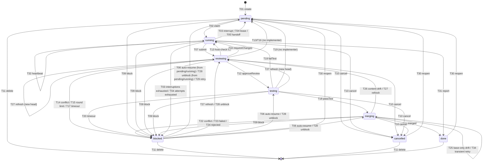
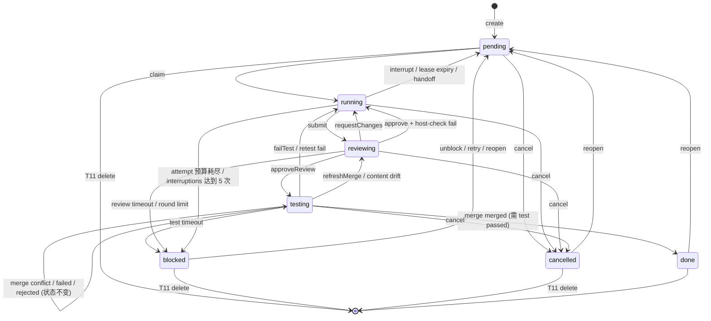

# 卡片状态机审计与目标状态机（T-200）

> 状态：v5（2026-11-19，重开任务 review round 1 修订） · 审计基线：提交 `e2d5d4d`（分支 `task/T-200-1` 的原始工作基线）
> 修订：见附录 E（v2/v3/v4/v5 逐条回应评审意见）
> 范围：只审计当前实现并给出目标状态机与实现拆分；**本文件不含实现改动**。
> 验证基线：源码逐函数核对 + `npm test` 73/73 通过（仅新增本文档）。
> 候选树说明：交付提交的父提交为 `67065ec`（`feat/task-center-v2`）。`e2d5d4d..67065ec` 只改 tester brief 的 Godot 主场景探测（`api.mjs` `readGodotProjectInfo`/`godotInfoFor`、`dispatch.mjs` `testerBriefFor`），不涉及任何卡片状态转移，本文的现状转移与函数名引用对该区间仍然成立。
> 关联文档：`docs/refactor/STAGE-CONTRACT.md`（阶段契约 v4）、`docs/refactor/ARCHITECTURE.md`（模块边界）、`docs/refactor/TESTING.md`（测试金字塔）。
> 行号说明：行号取自 `e2d5d4d`；函数名与文件路径比行号稳定，引用时两者都给。候选树 `67065ec` 中 `api.mjs` 行号约 +69~+78、`dispatch.mjs` 在 `testerBriefFor` 之后约 +16（其他文件未变），实现/评审请按函数名定位并重锚行号。

---

## 0. 结论摘要

1. **当前没有状态机，只有 7 个阶段名的平铺列表。** `STATUSES`（`schema.mjs:51`）是一维数组；没有 (from, event, to) 表，也没有唯一的 status 写入口。`status` 被 `service.mjs`、`merge.mjs`、`handoff.mjs`、`board.mjs` 分别直接赋值；`board.mjs` 读到未知状态时静默回退为 `pending`（`board.mjs:678`）。
2. **`testing` 同时表示“测试进行中”和“测试通过、等待合并”。** 前者 `test.status==='pending'`，后者 `test.status==='passed'` 且 `merge.status==='open'`；两者 status 相同，看板列、计数、超时策略无法区分（详见 G1）。
3. **合并结果没有状态出口。** `recordMergeResult` 只在 `merged` 且原状态为 `testing` 时写 `done`（`merge.mjs:973`）；`conflict` / `failed` / `rejected` 只改 `merge.status`，卡片仍停在 `testing`（`reviewing` 被 reject 时停在 `reviewing`），且不再满足 `mergeEligible`，也没有扫掠会处理它（详见 G2）。
4. **目标漂移（target moved）有三条不一致的路径**：自动 base-only 快路径（直接合并、不加轮次）、`passTest` 后的 stale 重建（新增测试轮）、显式 `refreshMerge`（新增评审轮）。同一外部事件按谁先发现而得到不同结论（详见 G3）。
5. **目标状态机：8 个状态**（`pending / running / reviewing / testing / merging / done / blocked / cancelled`），**唯一 status 写入口**（`service.mjs` 的 transition 函数），**阶段字段只是投影**（review/test/merge 记录不再被用来推断卡片状态），**blocked 带 blockedFrom + blockedReason**，**每个事件明确幂等与拒绝码**。迁移用 `BOARD_VERSION 3`。
6. 实现建议拆 6 张卡（第 6 节）：内核与迁移 / 阶段拆分 / 生命周期与权限 / watchdog 与自动恢复 / 面板读取模型（两屏文件量拆分）。

---

## 1. 当前状态集合与正交字段

### 1.1 状态表（现状）

来源：`plugin/task-center/schema.mjs:51`，注释在 `schema.mjs:47-50`、`service.mjs:10-16`。

| status | 当前含义 | 谁写入（当前） | 进入自 | 离开到 | 终态 |
| --- | --- | --- | --- | --- | --- |
| `pending` | 未派发；“就绪”由依赖图派生，不落盘 | `createTask`、`interruptDispatch`、`expireLeases`、`reopenTask`（`unblockTask` 委托它）、`retryTask`、`failDispatch`（无人调用）、`handoff.applyTakeover`、读盘迁移 | ∅（create）、running（interrupt/租约过期/handoff）、done/cancelled/blocked（reopen）、pending/blocked（retry） | running（claim）、blocked（block/watchdog）、cancelled、∅（delete） | 否 |
| `running` | 被 worker 持有，带 60 分钟租约；claim 本身就是互斥锁（`service.mjs:559-562`） | `claimTask`、`requestChanges`、`failTest`（含 `approveReview` 的 hostCheck 失败复合路径） | pending（claim）、reviewing（requestChanges）、testing（failTest） | reviewing（submit）、pending（interrupt/租约过期/handoff）、blocked、cancelled、done（investigate 的 report） | 否 |
| `reviewing` | 已提交，评审轮开放；实际评审者记录在 `review.deliveredTo` | `submitTask`、`refreshMergeRequest` | running（submit）、testing（refresh）、reviewing（refresh 自环） | testing（approveReview）、running（requestChanges；approveReview+hostCheck 失败复合写的最终值）、reviewing（refresh 自环）、blocked、cancelled、∅（delete） | 否 |
| `testing` | **双义**：测试轮开放（`test.pending`）或测试通过等待合并（`test.passed` + `merge.open`）；写入只发生在开轮时，`passTest` 不改 status | `approveReview`、`recordCandidate(retest)`（`merge.mjs:921`） | reviewing（approveReview）、testing（retest 自环） | done（合并成功）、running（failTest）、reviewing（refreshMerge/目标漂移）、testing（retest 自环；passTest 与 base-only 重建不写 status）、blocked、cancelled、∅（delete） | 否 |
| `done` | 合并成功（dev）或已交报告（investigate）；满足依赖 | `recordMergeResult`、`reportTask` | testing（合并）、running（investigate 的 report） | pending（reopen）、∅（delete） | 是 |
| `blocked` | 需要人处理：手动 block、死 worker、尝试耗尽、超时、评审轮数上限、合并失败 | `blockTask`（手工/系统 watchdog/轮数上限） | pending/running/reviewing/testing（任意非 done/cancelled/blocked） | pending（unblock/retry/reopen）、cancelled（cancel）、∅（delete） | 否（可恢复） |
| `cancelled` | 放弃 | `cancelTask` | pending/running/reviewing/testing/blocked（任意非 cancelled/done） | pending（reopen）、∅（delete） | 是 |

> 本表是审计摘要：写入点与复合路径以 1.4 与 §2 为准（例如 `approveReview` 的 hostCheck 失败在同一 action 内先写 testing、再由 `failTest` 写 running）；“离开到”包含 cancel/delete 与 refresh/retest 自环。

补充事实：

- `CLOSED_STATUSES = ['done','cancelled']`（`schema.mjs:54`）；`blocked` **不在**关闭集合里，但它是“可恢复的暂停”，不是进行中。
- 看板列顺序固定为 dispatch / running / reviewing / testing / done / blocked / cancelled（`client/src/views/board.cjs:55-66`）。
- 读盘时：不在 `STATUSES` 里的状态一律变 `pending`；历史状态 `'review'` 变 `done`（`board.mjs:678`）。v1 板迁移另有映射表（`board.mjs:826-841`）。

### 1.2 正交字段（现状）

| 字段 | 结构 | 写者 | 生命周期 | 与 status 的当前关系 |
| --- | --- | --- | --- | --- |
| `kind` | `'dev'` / `'investigate'` | create（不可改，`service.mjs:303-305`） | 永久 | 决定走 dev 流水线还是 report 直达 done |
| `dispatch` | `{status, at, target, targetId, via, error, host, lead, leadSession, session, project, ownerCompat, compat, compatDetail, keep}` | `claimTask`、`attachWorker`、`recordDispatch`、`submitTask`、`requestChanges`、`failTest`、`interruptDispatch`、`expireLeases`、`failDispatch`（未调用）、`handoff` | 从 claim 到下一次 claim；submit 后保留 | 仅供追溯：`status` 值（claimed/sent/submitted/changes-requested/test-failed/lease-expired/exhausted/interrupted/handoff）与卡片状态无映射表 |
| `review` | `{status: pending/approved/changes-requested, by, byName, at, reasons, record, attempt, deliveredTo}` | `submitTask`（开轮）、`approveReview`、`requestChanges`、`refreshMergeRequest`、`recordDeliveredTo`、`applyTakeover`（清 deliveredTo） | 每轮一份；`reviewing` 下应为 pending（retry 可残留旧记录） | 允许出现 `review.status==='pending'` 而卡片状态不是 reviewing（retry 保留旧记录、reopen 清空） |
| `test` | `{status: pending/passed/failed, by, byName, at, evidence, record, attempt, deliveredTo, hostCheck}` | `approveReview`（开轮）、`passTest`、`failTest`、`recordCandidate(retest)`、`recordDeliveredTo` | 每轮一份 | `test.passed` 只在 `testing` 出现；但 `testing` 也可以是 `test.pending` |
| `merge` | `{status（无枚举的字符串）, base, target, head, mergeCommit, declaredFiles, actualFiles, tests, reviewer, conflict, output, at, rebuildAttempts, targetDrift, verifyChanged, verifyFingerprints, artifact}` | `submitTask`、`recordCandidate`、`recordMergeResult`、`refreshMergeRequest`、`rebuildAndMergeStale`、submit 的 prepareMergeRequest | 从 submit 起；done 后保留 | `merge.status` 与卡片状态没有强约束：`open` 可以出现在 `testing`，`rejected` 可以出现在 `reviewing` 或 `testing`，`merged` 可以出现在被 reopen 的 `pending` 卡上 |
| `report` | `{summary, body, evidence, artifacts, probeCommits, createdAt, by, byName}` | `reportTask` | investigate 专用 | 只有 investigate + done 时有值 |
| `assignee` | `{name, session}` | `claimTask`；被 `cancelTask`/`blockTask`/`interruptDispatch`/`expireLeases`/`reportTask` 清空；**submit/approve/pass/fail/merge 都不清** | 从 claim 起，可能跨 reviewing/testing/done 保留 | 名义上是“当前实现者”，实际是粘性字段；actor gate 大量依赖它 |
| `lastAssignee` | 同 assignee | cancel/block/interrupt/expire/report 在清空前保存 | 审计 | 供 stoppedTaskRefusal 识别已离开的 worker（`api.mjs:3445-3480`） |
| `executors` | `[{name, session, at, retiredAt, retiredReason}]`（最多 8 条） | claim（retire 旧 + push 新）、interrupt/expire/failDispatch/cancel/block（retire）、handoff（retire） | 从 first claim 起 | submit/approve/pass/fail/merge **不 retire**，因此 reviewing/testing 卡的 ledger 里仍有未退休条目 |
| `leaseUntil` | ISO 时间 | `claimTask`、`requestChanges`、`failTest`、`extendLease`、`renewRunningLeases` | 只在 running 有意义；submit/cancel/block/interrupt/expire/report 清空 | 与 status 没有强不变量（手工板可能有 running 无租约） |
| `attempts` / `interruptions` / `maxAttempts` | 整数 | claim（+1）、interrupt（−1、interruptions+1）、retry/reopen（清零）、failDispatch（不加） | 永久 | 预算只由 lease 过期与中断消耗；spawn/worktree 失败不消耗 |
| `waitingReason` / `waitingDetail` | 字符串 | `markWaiting`（`api.mjs:1944`）、`markExecutorMissing`（`dispatch.mjs:2809`）、`recoverWaiting`/merge 路径 | 直到被 clearWaiting 或新状态写入清掉 | **第三种正交标志**：`agent-runtime-unavailable`、`reviewer-unavailable`、`tester-unavailable`、`candidate-stale`、`needs-rebase`、`dirty-worktree`；不改变 status，但会暂停 watchdog 与 auto-merge |
| `ownerSession` | string | create（`actions/task-admin.mjs:56-67`）、handoff、writeTask 首次写入 | 永久 | 决定谁能拿到卡；actor gate 不读它 |
| git 字段 | `base, targetBase, target, branch, worktree, worktreeError, commit, actualFiles, verifyFingerprint` | claim、submit、refresh、merge 路径 | 从 claim 起；done/reopen 后保留 | 与 status 无强约束；delete 不清理 |
| `history` | 每行 `{at, by, byName, from, to, note(, fromSession/toSession/...)}`（最多 120 行） | 所有转移与部分非转移写入 | 永久 | 唯一的状态审计轨迹；但 `from===to` 的噪声行很多（lease extended、update、candidate built） |

### 1.3 状态与字段的“允许组合”（现状，事实描述）

| 字段 | pending | running | reviewing | testing | done | blocked | cancelled |
| --- | --- | --- | --- | --- | --- | --- | --- |
| assignee | null | 必须有 | 通常保留 worker | 通常保留 worker | 可残留 | null | null |
| leaseUntil | null | 必须 | null | null | null | null | null |
| 活 executor | 无 | 恰 1 个 | ledger 里有未 retire 的旧条目 | 同左 | 同左 | 全部 retired | 全部 retired |
| 文件锁 | 无 | 持有 | submit 时释放（action 层） | 无 | 无 | 释放 | 释放 |
| review | null 或历史 | null 或历史（pending 也可能残留，见 retry） | pending | approved | approved | 任意 | 任意 |
| test | null 或历史 | 历史 | null | pending 或 passed | passed | 任意 | 任意 |
| merge | null 或历史 | 历史 | open 或历史 | open 或非 open | merged | 任意 | 任意 |
| blockedReason | 无此字段 | 无此字段 | 无此字段 | 无此字段 | 无此字段 | 无此字段（用 waitingReason） | 无此字段 |
| waitingReason | 可（dirty-worktree） | 可（执行者缺失） | 可（candidate-stale/needs-rebase/executor） | 可（同左） | 无 | 可 | 可（历史残留） |

> 目标状态机（第 4 节）会把 `merging` 变成真实状态，并把上表的“通常/可能”改成硬不变量（见 4.5）。

### 1.4 当前 status 的写者分布（审计证据）

直接给 `task.status` / `status:` 赋值的生产代码（grep 结果）：

- `service.mjs`：237（create）、579（claim）、709（interrupt）、827（failDispatch）、875（expireLeases）、957（submit）、1015（approveReview）、1044（requestChanges）、1107（failTest）、1129（cancel）、1197（report）、1223（reopen）、1259（block）、1284（retry）。
- `merge.mjs`：921（recordCandidate retest）、973（recordMergeResult merged）、1066（refreshMergeRequest）。
- `handoff.mjs`：272（applyTakeover running→pending）。
- `board.mjs`：678（读盘回退）、841（v1 迁移）。
- 没有任何模块在写 status 前查询“这条转移是否合法”。

---

## 2. 当前实际转移（逐条）

记法：**from → to** 指一次板写入后的最终 status；同一 tool call 内可能发生多次写，复合路径单独标注。actor 取值：`user`、`scheduler`、`host`、`worker(assignee)`、`reviewer(deliveredTo)`、`tester(deliveredTo)`、`any-agent`。

### A. 创建与分派

| ID | 事件（入口 → 模型函数） | from → to | guard（现状） | 副作用 | actor |
| --- | --- | --- | --- | --- | --- |
| A1 | `create`（`actions/task-admin.mjs:43` → `service.mjs:196 createTask`） | ∅ → pending | 标题非空；kind ∈ dev/investigate；dev 卡过 card model（acceptance 最多 6、probes 最多 8 且必填，`schema.mjs:503`）；`verify`/`verification` 严格校验；dependsOn 同 target、无环、非 cancelled（`service.mjs:173-194`）；target 存在性由 action 的 `checkTarget` 校验 | 分配 T-n；写 `ownerSession`（action 层）；history 首行；`status='pending'`（237） | any-agent 或 user（无 owner/role gate） |
| A2 | `claim`（`dispatch.mjs:2883-2912` → `service.mjs:562 claimTask`） | pending → running | `status==='pending'`（565）；依赖 ready（`dependencyInfo`，528-544；依赖须 done 且 merged，investigate 例外，517-523）；writeFiles 无锁冲突（`dispatch.mjs:2837-2840`）；subagent runtime 可用、worktree 创建成功（2833-2870） | attempts+1（586）；assignee（581-584）；lease = now+60min（585）；retire 旧 executor + push 新 executor（589-590）；base/targetBase/verifyFingerprint/target/branch/worktree（591-600）；dispatch 记录（601-624）；acquire 文件锁（2842-2854）；history pending→running（626-645） | scheduler（唯一 running 生产者） |
| A3 | `start` / `pause` / `settings` / `tick`（`actions/task-admin.mjs:109`、`actions/control.mjs:17,27,50` → `service.mjs:417-505`） | 卡片状态不变；只改 `board.dispatch` | start：preflight/worktree/Session；agent 调用 start 只写 request 并返回 `needs-consent`（agent 不启动）；user 才能 `approveStart`；settings user-only；重复 start 返回 `alreadyRunning` | dispatch.state/request/since/by/pauseSource/pauseReason/error；scheduler.settle | user、agent（request）、scheduler（tick） |
| A4 | 宿主重启/丢失 worker（`dispatch.mjs:2433-2470` → `service.mjs:695 interruptDispatch`） | running → pending；`interruptions >= 5` 且无 commit → blocked | `status==='running'`（699）；`dispatch.host !== boot`（2433-2435） | attempts−1（refund，705）；interruptions+1（706）；retire executors（711）；assignee/lease null（712-713）；dispatch.status=interrupted/exhausted（714-718）；action 层释放锁（2454）；history（720-729） | scheduler |
| A5 | 租约过期/交接（`dispatch.mjs:2479-2538` → `service.mjs:863 expireLeases`；活着的持有者先 `extendLease` 1329） | running → pending；attempts >= maxAttempts → blocked | leaseUntil 过期（2479-2481）；holder 不 alive 或超过 4h 扩展上限（2487-2505） | assignee/lease null（876-878）；dispatch.status=lease-expired/exhausted（879-883）；action 层释放锁（2528）；stop 旧 agent（2529）；history（885-894） | scheduler/system |
| A6 | handoff 接管（`onboard` → `handoff.mjs:245 applyTakeover`） | running → pending；reviewing/testing **状态不变**，只换 ownerSession | owner session 陈旧/未知且所有 executor 不 alive（188-213） | running：lastAssignee、assignee/lease null、executors retired、dispatch.status=handoff（269-283）；reviewing/testing：open round 的 deliveredTo 清空（287-303）；ownerSession（304）；history 带 fromSession/toSession（306-323） | user |

### B. 实现 → 评审

| ID | 事件（入口 → 模型函数） | from → to | guard（现状） | 副作用 | actor |
| --- | --- | --- | --- | --- | --- |
| B1 | `submit`（`actions/submit.mjs:33` → `service.mjs:911 submitTask`） | running → reviewing | assignee（`api.mjs:3575-3583 taskForContext`）；`status==='running'`（919）；kind=dev（916-918）；生产改动最多 250 行（925-932）；`prepareMergeRequest` 成功；reviewer runtime 可用（59-62），否则停在 running 并写 waitingReason | evidence/commit/actualFiles/merge（935-938）；targetBase/verifyFingerprint 与变更标记（942-953）；interruptions=0（956）；status reviewing（957）；lease null（958）；review round+1 pending（959-966）；dispatch submitted（967-970）；action 层释放文件锁（84-89）、清 tester slot（86）、启动 reviewer 并记录 deliveredTo（104-110） | worker(assignee)，user 亦可 |
| B2 | `update`（`actions/task-admin.mjs:77` → `service.mjs:297 updateTask`） | 状态不变 | 不可改 kind（303-305）；不可写 host-only 字段（306-309）；running 时不可改依赖（310-312）；dev 卡不得被改出 card model（323-335） | 字段更新 + history（from===to） | any-agent 或 user（无 owner gate） |

### C. 评审阶段

| ID | 事件（入口 → 模型函数） | from → to | guard（现状） | 副作用 | actor |
| --- | --- | --- | --- | --- | --- |
| C1 | `approveReview`（`actions/review-verdicts.mjs:123-388` → `service.mjs:995 approveReview`） | reviewing → testing | review.pending（1000）；kind=dev（998）；action 层校验 ReviewRecord（145-149，checked 非空）；candidate 构建 + hostCheck（156-257），冲突则停在 reviewing 并写 waitingReason（169-184），不转移 | review approved+record（1003-1006）；test round+1 pending（1007-1014）；status testing（1015）；action 层启动 tester 并记录 deliveredTo（344-377） | reviewer(deliveredTo) 或 user；assignee 被拒（`kernel/verdict-gate.mjs:25-30`） |
| C2 | `requestChanges`（同入口 → `service.mjs:1029`） | reviewing → running | review.pending（1034）；至少 1 条 blocking finding（action 层 145-152 渲染 reasons） | review changes-requested+record（1039-1043）；lease 续期（1045）；dispatch changes-requested（1046）；action 层发 rework brief（337-343） | 同 C1 |
| C3 | `approveReview` + hostCheck 失败（复合：`review-verdicts.mjs:262-301`） | reviewing → testing（approveReview）→ running（`service.mjs:1094 failTest`，同一板写内） | hostCheck exit 非 0 或超时（239、272-278） | review approved+record、test failed+record+evidence、candidate 丢弃（322-329）、通知 worker（332-335）；history 两条 | reviewer + host（failTest 的 by='host'） |
| C4 | review 超时 watchdog（`dispatch.mjs:2589-2683` → `service.mjs:1252 blockTask`） | reviewing → blocked | review.pending 且静默 >= 2×10min + 2min grace（2616）；deliveredTo 有值；waitingReason 为空（2593） | block 的全部清理（retire executors、lease/assignee null、释放 stage children 2642、stop reviewer 2646、通知 owner 2648-2653） | system |
| C5 | 评审轮数上限（submit 完成后，`api.mjs:1309-1335`） | reviewing → blocked | `review.attempt > REVIEW_MAX_ROUNDS(3)`（1311） | blockTask（1317）+ release 所有 stage children（1325）+ 通知（1331） | system |
| C6 | candidate 构建冲突（`review-verdicts.mjs:168-184`） | **状态不变（仍 reviewing）** | candidate code=candidate-conflict | 写 waitingReason=needs-rebase（分支 behind）或 candidate-stale（+rebuildAttempts++），返回失败；不推进 | host |
| C7 | `refreshMerge` 作用于 reviewing 卡（`actions/merge.mjs:80-169` → `merge.mjs:1026 refreshMergeRequest`） | reviewing → reviewing（新评审轮） | 卡片非 pending/running/blocked/cancelled（90-92）；merge 记录存在（94-96）；actor 是 user 或 assignee（97-108）；branch/target head 可读；**不检查 base/head 是否真的变了** | merge open + base/head/actualFiles/mergeCommit 清空（1048-1058）；review round+1（1067-1073）；test=null（1074）；启动 reviewer 并记录 deliveredTo（143-165） | user 或 assignee；其他 agent 被拒 |
| C8 | 记录评审者（`api.mjs:1194 recordDeliveredTo`、`applyTakeover`） | 不变 | 无 | 写 review.deliveredTo；handoff 时清空 | host/user |

### D. 测试阶段

| ID | 事件（入口 → 模型函数） | from → to | guard（现状） | 副作用 | actor |
| --- | --- | --- | --- | --- | --- |
| D1 | `passTest`（`actions/test-verdicts.mjs:91-213` → `service.mjs:1069 passTest`） | testing → testing（只改 test.status） | test.pending（1074）；kind=dev（1072）；TestRecord 校验，必须覆盖 artifact.probes（test-verdicts:126-131） | test passed+record（1077-1080）；action 层随后调用 `mergeTestedCandidate`（182-201），若 merge 成功则在**第二次板写**里 testing→done；释放 tester（162-176） | tester(deliveredTo) 或 user（人工 override 记录 human-override TestRecord，70-89） |
| D2 | `failTest`（同入口 → `service.mjs:1094`） | testing → running | test.pending（1099）；evidence 非空（1100-1101） | test failed+record+evidence（1104-1106）；status running（1107）；lease 续期（1108）；dispatch test-failed（1109）；action 层丢弃候选（202-209）、通知 worker（210） | tester、user、host（hostCheck 失败） |
| D3 | test 超时 watchdog（`dispatch.mjs:2693-2806` → `service.mjs:1252`） | testing → blocked | test.pending 且静默 >= 20min + 2min grace（2722）；waitingReason 为空（2697） | block 清理 + release stage children（2756）+ stop tester（2759）+ 通知 owner（2760-2765） | system |
| D4 | 目标移动后的 stale 重建（`mergeTestedCandidate` stale 分支，`api.mjs:874-1030`） | testing → testing（`recordCandidate(retest:true)` 921；随后 host verify） | mergeEligible 且 merge.mergeCommit 非空；`mergeCandidate` 返回 stale（`merge.mjs:803-805`） | 丢弃旧候选；从目标新 head 重建；跑 hostCheck；`recordCandidate(retest)` 写 test pending+attempt+1（912-921）；失败则 `failTest` 回 running（996）；成功则启动新 tester（1022-1029） | host |
| D5 | 人工 override（面板 passTest/failTest） | 同 D1/D2 | user 角色；structured record 可原样接受 | 同 D1/D2，record 由 `userOverrideTestRecord` 生成 | user |

### E. 合并阶段

| ID | 事件（入口 → 模型函数） | from → to | guard（现状） | 副作用 | actor |
| --- | --- | --- | --- | --- | --- |
| E1 | `mergeRequest` / auto-merge 成功（`actions/merge.mjs:35`、`api.mjs:4274 autoMergePending` → `api.mjs:3908 mergeOne` → `merge.mjs:953 recordMergeResult`） | testing → done | `mergeRefusal`（user-only，`kernel/gates.mjs:15-20`）或 host auto；`mergeEligible`（status testing + review approved + test passed + merge open，992-1005）；branch head 未漂移（3960-3974） | merge.status=merged + mergeCommit（961-973）；history；action 层释放 worker 会话（4008-4010）；`mergeCandidate` 移除 task worktree（`merge.mjs:699-702`） | user / host queue |
| E2 | 合并冲突（同上 → `recordMergeResult`） | **状态不变（仍 testing）** | merger 返回 status=conflict | merge.status=conflict + conflict（961-968）；history；通知 owner 修复（`api.mjs:386-399`） | host |
| E3 | 合并失败（同上） | **状态不变（仍 testing）** | merger 返回 status=failed（integration worktree 失败、main 变脏、verify 红、target 移动等，`merge.mjs:596-693`） | merge.status=failed + output；history；通知 owner | host |
| E4 | `rejectMerge`（`actions/merge.mjs:51-77` → `recordMergeResult`） | **状态不变**（reviewing 或 testing 都可） | user-only（36）；只拒绝 pending/running/blocked/cancelled（61-63）；merge.status 必须 open（65-67） | merge.status=rejected；history；通知 owner | user |
| E5 | head 漂移拒绝（`mergeOne` 3960-3973） | 不写板 | 当前 branch head 不等于 merge.head | 返回 `head-drift`，提示 refreshMerge；无副作用 | user/host |
| E6 | auto-merge 扫掠（`api.mjs:4274-4375`） | 同 E1 | `mergeEligible` 过滤（4305）；跳过 needs-rebase（4318）；每轮最多重建一次（4322） | 同 E1；写 `state.memory.lastSweep` 遥测 | host |
| E7 | auto base-only 快路径（`api.mjs:4078-4210 rebuildAndMergeStale`） | testing → testing → done | testing + merge open；branch head 等于已验证 commit（4100-4101）；重建候选并跑 verify；失败/差异则留在 testing + waitingReason（4107-4153） | 重建候选、verify、merge.base/mergeCommit 更新、targetDrift/verifyChanged 审计、history from===to note（4189-4198）、直接 `mergeTestedCandidate`（4206）→ done | host（autoMergePending 内调用） |
| E8 | 显式 `refreshMerge` 作用于 testing 卡（`actions/merge.mjs:80`） | testing → reviewing | 同 C7 | 同 C7：新评审轮 + test 清空 | user 或 assignee |
| E9 | 等待恢复扫掠（`api.mjs:4221-4271 recoverWaiting`） | reviewing → reviewing（refresh）；testing → testing（rebuild）；needs-rebase 跳过 | waitingReason 非空；kind 匹配状态；reviewer/tester runtime 可用 | 重新 provision stage child、清 waitingReason；candidate-stale testing 走 E7，diff changed 走 refreshMerge（4257-4262） | host |
| E10 | `refreshMerge` 作用于 **done** 卡（`actions/merge.mjs:80-169` → `merge.mjs:1026-1084`） | **done → reviewing** | action 的拒绝列表只有 pending/running/blocked/cancelled（`actions/merge.mjs:90-92`），**closed 卡通过**；done 卡仍挂着 merge 记录（`recordMergeResult` 不清 merge，`merge.mjs:953-984`）；actor 是 user 或 done 卡残留的 assignee（97-108）；branch/target head 可读 | merge.status=open、base/head 重定、review round+1（最小复现 attempt=2）、test=null、启动 reviewer（`merge.mjs:1048-1074`）；history 记 from done | user 或 done 卡 assignee（当前漏洞，目标必须拒绝） |

### F. 人工生命周期

| ID | 事件（入口 → 模型函数） | from → to | guard（现状） | 副作用 | actor |
| --- | --- | --- | --- | --- | --- |
| F1 | `block`（`actions/lifecycle.mjs:99-120` → `service.mjs:1252 blockTask`） | 任意非 done/cancelled/blocked → blocked | 状态检查（1255-1256） | lastAssignee 保存（1260）；retire executors（1261）；assignee/lease null（1262-1263）；action 层释放锁（111）、release 所有 stage children（115）、investigate 清理（117） | any-agent 或 user（无 owner gate） |
| F2 | `unblock`（`actions/lifecycle.mjs:69-97` → `service.mjs:1269 unblockTask`） | blocked → pending（**委托 reopenTask**） | `status==='blocked'`（1272） | 等价于 F5 的全部清理（review/test/report/attempts/interruptions/executors/dispatch 清空；merge/commit/worktree 保留）；release stage children（89） | any-agent 或 user |
| F3 | `retry`（`actions/lifecycle.mjs:69-97` → `service.mjs:1276 retryTask`） | blocked 或 **pending** → pending | 状态 ∈ {blocked, pending}（1279-1281） | assignee/lease null；attempts=0；interruptions=0；executors=[]；dispatch=null；**保留 review/test/report/merge/commit/worktree**（1282-1293） | any-agent 或 user |
| F4 | `cancel`（`actions/lifecycle.mjs:44-67` → `service.mjs:1122 cancelTask`） | 任意非 cancelled/done → cancelled | 非 cancelled（1125）、非 done（1126） | lastAssignee（1132）；retire executors（1133）；assignee/lease null（1134-1135）；action 层释放锁（58）、release stage children（61）、investigate 清理（64）；**保留** review/test/merge/commit/worktree | any-agent 或 user |
| F5 | `reopen`（`actions/lifecycle.mjs:69-97` → `service.mjs:1215 reopenTask`） | done、cancelled、blocked → pending | 状态 ∈ {done, cancelled, blocked}（1218-1220） | assignee/lease null；attempts=0；interruptions=0；executors=[]；dispatch=null；review=null；test=null；report=null（1232-1238）；**保留** merge/commit/worktree/branch/base/actualFiles；release stage children（89） | any-agent 或 user |
| F6 | `report`（`actions/report.mjs:23-75` → `service.mjs:1150 reportTask`） | running → done（investigate only） | kind=investigate（1153-1155）；running（1156）；summary 非空且最多 4KB（1158-1162） | report 记录（1187-1196）；status done（1197）；assignee/lease/dispatch 清空（1198-1202）；action 层释放锁（46）、写 `.agents/reports/<id>.md`（50-59）、清理 scratch（60） | worker(assignee)（taskForContext） |
| F7 | `delete`（`actions/task-admin.mjs:95-107` → `service.mjs:388 deleteTask`） | 任意非 running → ∅ | 非 running（392）；被未关闭卡引用时需 force（393-400） | 从 board 移除；依赖它的卡去掉该依赖并记 history（403-408）；action 层释放锁（104-106）；**不清理 worktree/branch、不 release stage children、无项目级审计** | any-agent 或 user |

### G. 读盘/维护/非转移

| ID | 事件 | from → to | 说明 |
| --- | --- | --- | --- |
| G1 | 读盘规范化（`board.mjs:663-820 normaliseTask`） | 未知 → pending；`'review'` → done | 静默改写，无 history（v1 迁移除外，`board.mjs:841-853` 会记一行） |
| G2 | heartbeat / 续租（`api.mjs:3392-3415`、`service.mjs:1300-1386`） | running → running | 只续 `leaseUntil`，不改 status，不写 history（`renewRunningLeases`） |
| G3 | lease 延长（`service.mjs:1329-1346 extendLease`） | running → running | 写 history 行（from===to）；用于活着的持有者 |
| G4 | 活动/通知（`emitActivity`、`notifyMergeOutcome`、`sendAssignee` 等） | 不变 | 外部副作用，不写 status |
| G5 | `counts` / `summary` / `detail`（`service.mjs:1390-1490`） | 只读 | `counts.testing` 把“测试中”和“等待合并”混在一起 |

### 2.1 覆盖核对（任务要求的事件 → 本文条目）

| 要求覆盖 | 本文条目 |
| --- | --- |
| create | A1 |
| claim / start | A2（claim）；A3（start 不产生卡片转移） |
| submit | B1 |
| requestChanges | C2 |
| approveReview | C1、C3 |
| passTest | D1（+D5） |
| failTest | D2（+D5）、C3 |
| merge merged | E1、E6、E7 |
| merge rejected | E4 |
| merge conflict | E2 |
| merge failed | E3 |
| target drift rebuild / refresh | E7（自动）、D4（stale 重建）、E8/C7（显式 refresh） |
| block | F1、C4、C5、D3 |
| unblock | F2 |
| retry | F3 |
| cancel | F4 |
| reopen | F5 |
| report | F6 |
| interrupt / lost worker | A4、A5（租约过期/交接） |
| delete | F7 |
| （补充）update | B2 |
| （补充）handoff | A6 |
| （补充）读盘迁移 | G1 |
| （补充）refreshMerge on done | E10 |

---

## 3. 当前不一致与歧义

以下 15 条全部可在当前提交复现。**G1–G5 是本次任务点名要求核对项**，其余是审计中额外发现。

### G1（点名）`testing` 同时表示“测试中”和“测试通过、等待合并”

- **证据**：`mergeEligible` 要求 `status==='testing'` 且 review approved、test passed、merge open（`merge.mjs:992-1005`）；`passTest` 只把 `test.status` 改成 passed，status 不动（`service.mjs:1069-1091`）；`counts.testing` 把两类卡混计（`service.mjs:1390-1412`）；看板 testing 列按 status 分（`client/src/views/board.cjs:59`）；测试超时 watchdog 只筛 `test.status==='pending'`（`dispatch.mjs:2693-2702`）。
- **影响**：看板/计数/报表不能区分“测试者在跑”和“等合并”；`passTest` 到合并之间如果是两次板写（auto-merge 关闭、merge 队列忙、merge 失败），卡片就永远停在“testing 但没有 watchdog”的区域；阶段字段与卡片状态互相替代。
- **目标处置**：新增 `merging` 状态，`passTest` 是唯一生产者；`testing` 只表示测试轮开放。

### G2（点名）merge `rejected` / `conflict` / `failed` 之后 status 仍是 `testing`

- **证据**：`recordMergeResult` 仅当 `outcome.status==='merged' && task.status==='testing'` 才写 done（`merge.mjs:953-984`，判断在 973）；conflict/failed 来自 `mergeCandidate`/`mergeRequest`（`merge.mjs:596-693`、`api.mjs:4003`）；`rejectMerge` 只挡 pending/running/blocked/cancelled（`actions/merge.mjs:61-63`），所以 reviewing 卡也能被写成 `merge.status=rejected`（71）。
- **影响**：卡片停在 testing/reviewing 且 `merge.status` 非 open，`mergeEligible` 为 false，`autoMergePending` 不会再看它（4305 只取 eligible）；没有任何扫掠处理 rejected；只有人工 `refreshMerge` / `block` / `reopen` 才能离开。这就是“testing 但永远不能合并”的僵尸态。
- **目标处置**：`merging` 下按合并结果显式转移：merged→done，conflict/failed/rejected→blocked（带 blockedReason），不再原地停留。

### G3（点名）target drift 的两条（实际三条）路径互不一致

- **证据**：
  1. 自动 base-only 快路径 `rebuildAndMergeStale`（`api.mjs:4078-4210`）：重建候选 + host verify 后直接合并，**不新增评审轮、不新增测试轮**，history 的 from/to 都是 testing（4189-4198）。
  2. `passTest` 后的 stale 路径 `mergeTestedCandidate`（`api.mjs:874-1030`）：丢弃并重建候选、跑 hostCheck，`recordCandidate({retest:true})` 把 test 重置为 pending 并 **新开测试轮**（974-1010），再启动一个新 tester（1022-1029）。
  3. 显式 `refreshMerge`（`actions/merge.mjs:80-169` → `merge.mjs:1026-1084`）：**新开评审轮**（review.attempt+1）并清空 test（1064-1074）。
- **额外问题**：`refreshMerge` 不比较新旧 base/head，重复调用会不断消耗评审轮（`REVIEW_MAX_ROUNDS=3`，`dispatch.mjs:243`），且路径 1/2/3 谁先发现取决于 auto-merge 扫掠与 passTest 的时序。
- **影响**：同一个“目标分支前进”事件，可能得到“直接合并”“重新测试”“重新评审”三种结果；测试/评审预算不可预测；review.attempt 可能被无意义的刷新耗尽。
- **目标处置**：唯一规则：**内容未变（branch head 等于已测 commit）→ 重建并复跑 host verify，留在 merging 直接合并**；**内容变了（branch head 移动）→ reviewing 新评审轮**；显式 refresh 只在 (base,head) 真的变化或 merge 结果非 open 时生效，否则返回 `no-change`。

### G4（点名）`blocked` 与 `cancelled` 释放 executor/lock 相同，但依赖与恢复语义不同

- **证据**：两者都 `retireExecutorsIn`、清 assignee/lease，action 层都释放锁并 release 所有 stage children（`actions/lifecycle.mjs:58-61,111-115`；`service.mjs:1122-1139,1252-1267`）。但：
  - `dependencyInfo` 把 cancelled 依赖记为 **broken**（依赖者永远不能派发），blocked 依赖记为 **waiting**（`service.mjs:528-544`）。
  - `CLOSED_STATUSES` 只有 done/cancelled，不含 blocked（`schema.mjs:54`）。
  - 恢复：blocked 有 unblock/retry/reopen 三条入口，cancelled 只有 reopen；delete 两者都可（F7）。
- **影响**：看起来相似的“停下来”语义完全不同，但没有文档；上游分支 cancelled 会让下游卡静默变成 broken，必须人工 force-detach；看板把 blocked 放在“进行中”列而 cancelled 是终态列。
- **目标处置**：明确 cancelled 是终态（依赖者 broken 是设计决定，需在 UI 提示并可一键 detach）；blocked 是可恢复暂停，必须记录 blockedFrom 与 blockedReason；两者都不得被当作“工作已完成”。

### G5（点名）`retry` 与 `reopen` 清字段不同（且 unblock 等价于 reopen）

- **证据**：`retryTask` 清 assignee/lease/attempts/interruptions/executors/dispatch，保留 review/test/report/merge/commit/worktree（`service.mjs:1276-1296`）；`reopenTask` 额外清 review/test/report（1215-1250）；`unblockTask` 直接委托 `reopenTask`（1269-1274）。
- **影响**：
  - retry 后卡片可能带着 `review.pending` 处于 pending/running，旧轮次与新轮次混在一起；
  - **评审轮数上限陷阱**：被 `review-round-limit` block 的卡（review.attempt=4）retry 后 review 未清，下次 submit 立即 attempt=5，再次被 block（`api.mjs:1309-1335`），形成死循环；
  - unblock 会把“测试通过、等待合并”的候选/结论一起清掉，不是“恢复”而是“重来”；
  - reopen 一张 done+merged 的卡会保留 `merge.status='merged'`，卡片回到 pending 却显示 merged，`mergeEligible` 又为 false。
- **目标处置**：定义三种明确语义：`unblock`=回到 blockedFrom 并重排该阶段执行者；`retry`=从 blockedFrom ∈ {pending,running} 重新起尝试（重置 attempt/interruption，不重置轮次预算，round-limit block 禁止 retry）；`reopen`=新世代（清阶段记录与合并结果）。

### G6 没有转移表与唯一写入口

- **证据**：`STATUSES` 是平铺数组（`schema.mjs:51`）；status 赋值分布在 `service.mjs`、`merge.mjs`、`handoff.mjs`、`board.mjs`（见 1.4）；没有任何 `assertTransition`；`board.mjs:678` 把未知状态静默改成 pending。
- **影响**：新增/移动状态无法被静态或测试验证；一个拼写错误在重载后变成 pending（看起来像“没派发”）；无法写“所有合法转移都可达、所有非法转移都被拒”的测试。
- **目标处置**：`service.mjs` 新增 `transition(task, event, patch)`，从 `TRANSITIONS` 表查 (from, event) → to，否则抛 typed refusal；其他模块一律调用它。

### G7 字段生命周期与状态脱钩

- **证据**：`submitTask` 不清 assignee（933-980），`approveReview`/`passTest`/`failTest`/`recordMergeResult` 也不清；`executors` 在 submit 时不 retire（只有 cancel/block/interrupt/expire/handoff/failDispatch 会）；submit 的文件锁由 action 层释放（`actions/submit.mjs:84-89`）而不是模型，直接调用模型会漏锁。
- **影响**：`assignee` 被 actor gate 当作“当前持有者”（`refreshMerge` 的 owner 判断、`taskForContext`），但 reviewing/testing/done 卡也可能匹配；`liveExecutors` 对 reviewing 卡仍显示 1 个活执行者；锁/租约/执行者的“运行期资源”语义没有统一入口。

### G8 `merge.status` 没有枚举

- **证据**：`normaliseMerge` 只要求是字符串（`schema.mjs:1118-1146`）；`open/merged/conflict/failed/rejected/stale` 分散在 `merge.mjs` 与 `api.mjs`；`stale` 只是 queue 的返回值，不是板上的 status。
- **影响**：拼写错误的值会永久停留在卡片上，所有 gate 都不认识它，卡片卡在 testing；没有“按 merge 结果转移”的统一表。

### G9 `waitingReason` 是未声明的第三种标志

- **证据**：字段本身只在 `board.mjs:811-812` 规范化；写点 `api.mjs:1944 markWaiting`、`dispatch.mjs:2809 markExecutorMissing`、merge/rebuild 路径；读点散在 watchdog（`dispatch.mjs:2593,2697`）、auto-merge（`api.mjs:4318`）、`recoverWaiting`（4221-4271）；`waitingReasonOf` 还会为 pending 卡派生 `dispatch-paused/dependency/file-lock/concurrency`（`api.mjs:1977-1991`）。
- **影响**：卡片状态看起来没变，实际已经中止推进；`needs-rebase` 没有超时、没有退出扫掠；这是事实上的第 8 种状态，却没有进入状态机。

### G10 “dispatch 失败”不是可达转移

- **证据**：`failDispatch`（`service.mjs:820-851`）在 `plugin/` 与 `scripts/` 中没有任何调用者；`attachWorker`（650）、`retireExecutors`（739）、`noteDispatchRefused`（768）、`noteReuseRefused`（791）同样只在定义处出现。spawn/worktree/claim 失败在 `dispatchWithAgent` 里返回 `skipped/error`，卡片保持原状且**不消耗 attempt**（`dispatch.mjs:2862-2911`）。
- **影响**：attempts 预算只被 lease 过期和中断消耗；一个永远 spawn 不出来的卡不会 block，只会一直 pending；死代码让“当前状态集合”看起来比真实多一个转移。

### G11 `delete` 不是安全的终止转移

- **证据**：`deleteTask` 只拒绝 running（`service.mjs:392`）；reviewing/testing/merging 卡可直接删；action 层只释放锁（`actions/task-admin.mjs:104-106`），不 release stage children，也不移除 worktree/branch（worktree 清理是另一个 user-only 动作，`actions/project-admin.mjs:21-29`）；卡片从 board 消失后没有项目级审计。
- **影响**：删除 reviewing/testing 卡会留下继续运行的 reviewer/tester（T-183 修过 cancel/block 的同类问题，delete 未覆盖）；残留 checkout 只能靠手动清理。

### G12 评审轮数上限的 retry 死循环

- **证据**：`enforceReviewRoundLimit` 在 submit 后检查 `review.attempt > 3` 就 block（`api.mjs:1309-1335`）；`retryTask` 不清 review（`service.mjs:1276-1296`），所以 attempt 仍是 4；再次 submit 后 attempt=5，再次 block。
- **影响**：卡片无法通过 retry 恢复，只能 reopen（清 review）或人工改板；这是 G5 的一个具体可复现故障。

### G13 状态词汇演进没有迁移保护

- **证据**：`board.mjs:875` 只拒绝高于当前版本的板；同版本内未知 status 被静默改成 pending（678）。`BOARD_VERSION` 当前为 2（`schema.mjs:22`）。
- **影响**：如果实现直接新增 `merging` 而不升版本、不写迁移，同版本旧板重载后所有 merging 卡会变成 pending。版本号是唯一护栏：旧插件读到更高版本会拒绝装载（`board.mjs:875`），所以“加状态必须升版本”是可执行的硬规则。

### G14 actor 权限只覆盖了少数动作

- **证据**：有 gate 的只有：`mergeRequest`/`rejectMerge`（user-only，`kernel/gates.mjs:15-20`）、`refreshMerge`（user 或 assignee，`actions/merge.mjs:97-108`）、review/test verdict（deliveredTo 或 user，`kernel/verdict-gate.mjs:14-35`）、`submit`/`report`（assignee，`api.mjs:3575-3583`）。`create/update/delete/cancel/reopen/block/unblock/retry` 没有任何 owner/role gate（`actions/registry.mjs:18-54` 只标了 scope:'agent'）；`stoppedTaskRefusal`（`api.mjs:3445-3480`）只在卡已 cancelled/blocked 时保护原 assignee。
- **影响**：任意子 agent 可以取消、阻塞、删除、重开另一个 session 的卡片；`assigneeMatches` 在 `task.assignee===null` 时返回 true（`kernel/caller-lookup.mjs:45-53`），`taskForContext` 因此会对“status=running 但缺 assignee”的旧板/手工板放行。

### G15 `refreshMerge` 可以把 done 卡拉回 reviewing

- **证据**：`actions/merge.mjs:90-92` 的状态门只拒绝 pending/running/blocked/cancelled，**done 不被拒绝**；`merge.mjs:1026-1084 refreshMergeRequest` 没有状态 guard，直接写 `status='reviewing'`（1066）；`recordMergeResult` 不清 merge 记录（`merge.mjs:953-984`），done 卡仍带 merge；done 卡的 assignee 也未清（G7），actor 检查（`actions/merge.mjs:97-108`）因此放行原 worker。2026-11-19 用最小 done 板直接调用 `refreshMergeRequest` 复现：`done -> reviewing`、`merge.status=open`、`review.attempt=2`。
- **影响**：closed 卡可以不经 reopen 回到 reviewing 并再走评审/合并，绕过 T30 与 X09 的“closed 只能 reopen”；merged 记录被改回 open，历史被重写；目标 T27 的 from 列表虽然不含 done，但实现若照抄 action 的负向状态列表就会保留这个漏洞。
- **目标处置**：T27 显式拒绝 closed（返回 `closed`/`illegal-transition`）；X09 写明含 refreshMerge；SM-2 把 action 的状态门改成“只接受 reviewing/testing/merging/blocked(merge-*)”，并用测试锁住 done/cancelled 拒绝。

---

## 4. 目标状态机

### 4.1 状态定义（8 个）

| status | 定义 | 进入/恢复路径（摘要） | closed | 备注 |
| --- | --- | --- | --- | --- |
| `pending` | 未认领；就绪由依赖图派生 | 新建 T01；回池 T03/T04/T05；**无 implementer 的返工 T13/T16/T19**；恢复 T06/T28（blockedFrom=pending/running）；重试 T29；重开 T30 | 否 | 不再承载任何“阶段轮次开放”的记录 |
| `running` | 实现阶段开放，恰好 1 个活执行者，持有租约与文件锁 | 新 claim T02；返工 T13/T16/T19（无 implementer 时先回 pending） | 否 | 新 attempt 的唯一产生者：`claim`；返工由三个阶段回退，不新增 attempt |
| `reviewing` | 评审轮开放（`review.status='pending'`），有一个投递对象，或由 user 直接裁决 | 新轮 T07 submit、T26 contentDrift、T27 refreshMerge；恢复 T06/T28（暂停的同一轮） | 否 | 新评审轮产生者：T07/T26/T27；恢复不增加 review.attempt |
| `testing` | 测试轮开放（`test.status='pending'`） | 新轮 T12 approveReview；恢复 T06/T28（暂停的同一轮） | 否 | 新测试轮产生者：T12；恢复不增加 test.attempt |
| `merging` | 测试已通过，合并请求 open，等待/正在合并 | 新轮 T18 passTest；恢复 T06/T28（暂停的同一轮） | 否 | 新合并轮产生者：T18；合并队列在这里消费 |
| `done` | closed：dev 的合并成功，或 investigate 的报告已交 | dev: `mergeMerged`；investigate: `report` | 是 | 不得再有 open merge/阶段 pending |
| `blocked` | 暂停，等待人或自动恢复；必须记录 `blockedFrom` + `blockedReason` | T09 block（任意非 closed）；T03 interruptions exhausted / T04 attempts exhausted；T14/T15/T17/T20 超时或冲突；T22/T23/T24 合并失败 | 否 | 可恢复；不允许推断成“进行中” |
| `cancelled` | closed：放弃 | `cancel` | 是 | 依赖者 broken（设计决定，UI 要显式提示） |

**closed 的定义**：`done` 与 `cancelled` 是 closed 状态，不是“不可再变”。只有显式 `reopen`（T30）能把它们改回 `pending`。`delete`（T11）允许 `pending`/`blocked`/`cancelled`；**closed 状态中只允许删 `cancelled`**，`done` 卡要先 reopen 或归档。除此之外，任何事件从 closed 出发都被拒绝（X09/X10）。`blocked` 不是 closed：它有 T06/T27/T28/T29/T30 五条明确出口。

### 4.2 阶段字段与卡片状态的分离（硬规则）

**R1. status 是唯一权威。** 任何 gate、看板、API 判断“卡片现在在哪一步”只读 `task.status`。`stage` 是**派生只读投影**，不落盘：

```js
stage = status === 'running'   ? 'implement'
      : status === 'reviewing' ? 'review'
      : status === 'testing'   ? 'test'
      : status === 'merging'   ? 'merge'
      : null
```

**R2. 禁止用阶段子状态反推卡片状态。** 反例（当前代码，必须在实现卡里修）：

- `mergeEligible` 用 `status==='testing' && test.status==='passed' && merge.status==='open'` 推断“可合并”（`merge.mjs:992-1005`）→ 改为 `status==='merging' && merge.status==='open'`。
- `mergeOne` 用 `task.status==='testing'` 判断阶段（`api.mjs:3932-3949`）→ 改为 `merging`。
- 看板 `TaskCard` 用 `status==='testing'` 同时渲染“测试中”和“已通过”（`client/src/views/task-card.cjs:118-136`）→ 拆成 testing/merging 两种展示。
- `DetailView` 用 history 里 `to==='testing'` 的条数推断测试轮数（`client/src/views/detail-view.cjs:144-150`）→ 读 `test.attempt`。
- `counts.testing` 混计两类（`service.mjs:1397`）→ 拆成 `testing` 与 `merging`。

**R3. 阶段记录只在对应状态内允许 `pending`。** 离开该状态的同一次写里，该轮必须落到终局值（approved/changes-requested/passed/failed）或被清空；唯一例外是卡片处于 `blocked` 且 `blockedFrom` 指向该阶段（暂停的开放轮，恢复后继续同一轮）。不允许 `status='running'` 同时 `review.status='pending'`。读盘时发现这种组合：可修复的按“该轮作废”修复并记 history，不可修复的拒绝装载并报 `invalid-phase-record`。

**R4. `merge.status` 有枚举。** `MERGE_STATUSES = ['open','merged','conflict','failed','rejected']`（`stale` 只是队列返回值，不落盘）。允许组合：

- `open`：正常生命周期中出现在 `reviewing`/`testing`/`merging`（T07 创建请求，T12/T18 延续，T26/T27 在新 head 上重写）；也可出现在 `blocked`（从 reviewing/testing/merging 暂停，请求保持 open 但不可入队）；迁移期允许旧 `testing`。**reviewing/testing 必须有 open**（与 INV、X22、4.9、附录 D#4 一致）；
- `merged`：只出现在 `done`；
- `conflict|failed|rejected`：只出现在 `blocked`；`failed` 由 T23 写入（确定性失败，或瞬态重试耗尽，见 4.8）；`cancelled` 保留最后值作审计（不参与任何 gate）；
- `null`：尚未 submit，或返工/中断/重试已作废旧请求（T02/T13/T16/T19/T29 负责清空）。

瞬态合并失败在重试预算内**不写** `failed`：保持 `merge.status='open'` 并把原因写入 `merge.retry`；达到 `MERGE_RETRY_LIMIT` 后由 T23 写 `failed` 并进入 blocked（见 4.8）。

**R5. `blockedReason` 取代 `waitingReason`。** `blockedReason = { code, detail, from, auto, at }`，`blockedReason !== null` 当且仅当 `status==='blocked'`；`from`（blockedFrom）∈ {pending, running, reviewing, testing, merging}，其他状态必须为 null。原来的 `agent-runtime-unavailable / reviewer-unavailable / tester-unavailable / candidate-stale / needs-rebase / dirty-worktree` 全部变成 `blockedReason.code`，并带 `from`（blockedFrom）决定恢复目标。不再有“状态没变但被 waitingReason 卡住”的第四种语义。

**R6. 唯一 status 写入口。** `service.mjs` 导出 `transition(task, event, patch)`；它从 `TRANSITIONS` 表查 `(event, task.status)` 到 `to`，不存在则返回 `illegal-transition`。其他模块（merge、handoff、dispatch、api、actions）一律调用它，不得直接写 `task.status`。用测试/grep 断言生产代码里除 `service.mjs` 外没有 `task.status = 'pending|running|...'` 形式的直接赋值。

**R7. 每个事件声明 from 集合与幂等键。** 重复调用返回 typed refusal（如 `not-running`、`no-pending-test`、`already-merged`、`no-change`），不静默成功；host 侧副作用（git merge、文件写）用现有 journal / token 机制保证最多一次。

**R8. 副作用与状态同事务。** 一个 transition 函数负责该状态进入/离开时的全部板级清理：lease、executor、assignee、dispatch 状态、open round 的 deliveredTo、history。action 层只负责外部副作用（启动/停止 agent、git、锁、报告文件）；锁的 acquire/release 由 dispatcher/action 负责，但“running 之外不得持有任务锁”由 model 的 post-condition 断言（测试覆盖）。

### 4.3 合法转移表（目标）

列：ID、事件、from → to、guard（必须全部成立）、actor、板级副作用、重复调用。

#### A 创建与分派

| ID | 事件 | from → to | guard | actor | 副作用 | 重复 |
| --- | --- | --- | --- | --- | --- | --- |
| T01 | create | ∅ → pending | 标题、kind、card model、deps、target | any-agent/user | id、ownerSession、history | 新卡 |
| T02 | claim | pending → running | status=pending；deps ready；无锁冲突；runtime/worktree 可用 | scheduler only | attempts+1、assignee、lease、executors、git 身份、dispatch=claimed、锁、**merge=null**（本轮请求只由 T07 生成） | `not-pending` |
| T03 | interrupt | running → pending 或 blocked | status=running；dispatch.host 不等于 boot | scheduler | attempts−1、interruptions+1、retire executors、清 lease/assignee、dispatch interrupted；达到 5 次且无 commit 则 blocked（blockedFrom=running、blockedReason=interruptions-exhausted） | `not-running` |
| T04 | leaseExpired | running → pending 或 blocked | lease 过期；holder 不 alive 或超过 4h 上限 | scheduler | 清 lease/assignee、dispatch lease-expired；attempts 达 max 则 blocked（blockedFrom=running、blockedReason=attempts-exhausted） | 只处理 running |
| T05 | handoffTakeover | running → pending；reviewing/testing/merging 不变 | owner 陈旧且无活 executor | user | 换 ownerSession；running 清 claim 并 retire；open round 清 deliveredTo；attempts 不变 | `no-takeover-targets` |
| T06 | autoResume | blocked → blockedFrom（reviewing/testing/merging）或 pending（blockedFrom=pending/running） | blockedReason.auto=true 且条件消失；目标阶段记录必须匹配（reviewing → review.status=pending；testing → review.status=approved && test.status=pending；merging → review.status=approved && test.status=passed），且目标为三个阶段时 merge.status 必须为 open | host | 清 blockedReason、重排执行者；目标 pending 时清 claim | 条件未消失则等待 |

#### B 实现 → 评审

| ID | 事件 | from → to | guard | actor | 副作用 | 重复 |
| --- | --- | --- | --- | --- | --- | --- |
| T07 | submit | running → reviewing | assignee；status=running；kind=dev；card budget；candidate 可建；reviewer runtime 可用 | assignee | commit/merge/artifact/evidence；review round+1 pending；清 lease/executor；**保留 assignee（implementer，返工要用）**；释放锁；启动 reviewer | `not-running` |
| T08 | update | 状态不变 | 不可改 kind/host-only；running 不可改 deps；不得改出 card model | owner/user | 字段 + history(from=to) | 无 |
| T09 | block | 任意非 closed、非 blocked → blocked | status 不属于 {done,cancelled,blocked} | owner/user/system | 记录 blockedFrom/blockedReason；清 lease/executor；assignee 转 lastAssignee 后清空；释放锁；dispose stage children | `already-blocked` |
| T10 | cancel | 任意非 closed → cancelled | status 不属于 {done,cancelled} | owner/user | 同 T09 清理（assignee 转 lastAssignee 后清空）；保留阶段记录为审计；investigate 清理 scratch | `already-cancelled` |
| T11 | delete | pending/blocked/cancelled → ∅ | user-only；无活 stage child；被引用需 force；不得删 done（先归档） | user | 依赖解绑、释放锁、可选清理 worktree、写项目审计 | `unknown-task` |

#### C 评审

| ID | 事件 | from → to | guard | actor | 副作用 | 重复 |
| --- | --- | --- | --- | --- | --- | --- |
| T12 | approveReview | reviewing → testing | review pending；ReviewRecord 合法；candidate 构建 + hostCheck 全绿 | delivered reviewer/user | review approved+record；test round+1 pending；清 deliveredTo；dispose reviewer；启动 tester | `no-pending-review` |
| T13 | approveReviewHostCheckFailed | reviewing → running 或 pending（无 implementer 时） | review pending；candidate 构建成功；hostCheck 失败/超时；assignee 非空，否则目标为 pending（`no-implementer`） | delivered reviewer/user | review approved+record；test failed+record+evidence（历史终局）；丢候选；**merge=null**（本轮请求作废，返工后重新 T07）；dispatch=test-failed；通知 worker | `no-pending-review` |
| T14 | candidateConflict | reviewing → blocked | candidate 冲突且分支 behind | host | blockedFrom=reviewing；blockedReason=needs-rebase（auto=false） | 只从 reviewing |
| T15 | reviewRoundLimit | reviewing → blocked | review.attempt > 3 | system | blockedFrom=reviewing；blockedReason=review-round-limit（auto=false，禁止 retry/unblock，只能 reopen） | 每轮一次 |
| T16 | requestChanges | reviewing → running 或 pending（无 implementer 时） | review pending；至少 1 条 blocking finding；assignee 非空，否则目标为 pending（`no-implementer`） | delivered reviewer/user | review changes-requested+record；**merge=null**；lease；dispatch=changes-requested；启动 worker | `no-pending-review` |
| T17 | reviewTimeout | reviewing → blocked | 静默达到 2×REVIEW_TIMEOUT + grace；round pending | system | blockedFrom=reviewing；blockedReason=review-timeout；dispose reviewer | 每轮一次 |

#### D 测试

| ID | 事件 | from → to | guard | actor | 副作用 | 重复 |
| --- | --- | --- | --- | --- | --- | --- |
| T18 | passTest | testing → merging | test pending；TestRecord 覆盖全部 probes | delivered tester/user | test passed+record；merge 必须 open；dispose tester；入 merge 队列 | `no-pending-test` |
| T19 | failTest | testing → running 或 pending（无 implementer 时） | test pending；evidence 非空；assignee 非空，否则目标为 pending（`no-implementer`） | delivered tester/user/host | test failed+record（历史终局）；**merge=null**；lease；dispatch=test-failed；丢候选；通知 worker | `no-pending-test` |
| T20 | testTimeout | testing → blocked | 静默达到 TEST_TIMEOUT + grace | system | blockedFrom=testing；blockedReason=test-timeout；dispose tester | 每轮一次 |

#### E 合并与目标漂移

| ID | 事件 | from → to | guard | actor | 副作用 | 重复 |
| --- | --- | --- | --- | --- | --- | --- |
| T21 | mergeMerged | merging → done | mergeEligible（status=merging、merge open、test passed）；branch head 等于 merge.head；target head 可读；verify 绿 | host queue/user | merge.status=merged+commit；清 lease/executor/assignee（assignee 转 lastAssignee）；释放锁；移除 task worktree；dispose worker | `already-merged` |
| T22 | mergeConflict | merging → blocked | queue conflict | host | merge.status=conflict+files；blockedFrom=merging；blockedReason=needs-rebase(auto=false)；dispose stage children；通知 owner | 只从 merging |
| T23 | mergeFailed | merging → blocked | queue failed（确定性），或瞬态失败重试达到 MERGE_RETRY_LIMIT（retry-exhausted） | host | merge.status=failed+output；blockedFrom=merging；blockedReason=merge-failed（auto=false） | 只从 merging |
| T24 | mergeRejected | merging → blocked | user reject；merge open | user | merge.status=rejected；blockedFrom=merging；blockedReason=merge-rejected(auto=false) | `no-open-merge` |
| T25 | baseOnlyDrift | merging → merging（无状态变化，记录事件） | merge.status=open；重建候选；branch head 等于已测 commit；host verify 绿；base 变了 | host | merge.base/head/mergeCommit 更新；targetDrift；保留 review/test 结论；不新增轮次 | 每 sweep 一次 |
| T26 | contentDrift | merging → reviewing | merge.status=open；branch head 不等于已测 commit（或 diff 变了） | host | merge open 重定 base/head；review round+1；test=null；targetDrift | 新 head 才触发 |
| T27 | refreshMerge | reviewing/testing/merging/blocked(merge-*) → reviewing | **closed（done/cancelled）拒绝（`closed`）**；merge 记录存在；(base,head,outcome) 至少一个变化，否则 `no-change`；actor user 或 implementer | user/assignee | merge open 重定 base/head；review round+1；test=null；outcome 清空；启动 reviewer | `no-change` |

#### F 恢复与报告

| ID | 事件 | from → to | guard | actor | 副作用 | 重复 |
| --- | --- | --- | --- | --- | --- | --- |
| T28 | unblock | blocked → blockedFrom（reviewing/testing/merging）或 pending（blockedFrom=pending/running） | blockedReason 可解除；blockedFrom ∈ {pending,running} 时目标为 pending；目标为 reviewing/testing/merging 时除 merge.status 必须为 open（conflict/failed/rejected 只能 T27，`merge-unresolved`）外，目标阶段记录还必须匹配（同 T06：reviewing → review.pending；testing → review.approved && test.pending；merging → review.approved && test.passed，否则 `phase-record-mismatch`）；review-round-limit 只能 reopen | user/owner | 清 blockedReason；目标为阶段时重排执行者并保持 merge open；目标 pending 时清 claim/merge；不重置轮次与 attempts | `not-blocked` / `merge-unresolved` / `phase-record-mismatch` |
| T29 | retry | blocked → pending | blockedFrom ∈ {pending,running}；**review-round-limit 禁止** | user/owner | attempts=0、interruptions=0、executors=[]、dispatch=null、assignee=null、blockedReason=null、**merge=null**（请求作废）；保留 review/test 终局记录 | `not-retryable` |
| T30 | reopen | done/cancelled/blocked → pending | 状态为 closed（done/cancelled）或 blocked | user | 新世代：review/test/report=null；merge 清空；若 merge 曾 merged 则清 branch/worktree/commit/base；attempts/interruptions=0、assignee=null、dispatch=null、blockedReason=null | `not-closed` |
| T31 | report | running → done | kind=investigate；assignee；summary 合法 | assignee | report 记录 + 文件；清 lease/executor；assignee 转 lastAssignee 后清空；dispatch=null；释放锁；清理 scratch | `not-running` |

> `unblock`（T28）与 `retry`（T29）都覆盖 blockedFrom ∈ {pending,running}：前者按 blockedFrom 映射（阶段来源→原阶段，pending/running→pending）、**不重置** attempts/interruptions；后者回 pending 并**重置**这两个计数。两者都不覆盖 review-round-limit（只能 T30 reopen）。

#### G 系统扫描

| ID | 事件 | from → to | guard | actor | 副作用 | 重复 |
| --- | --- | --- | --- | --- | --- | --- |
| T32 | heartbeat | running → running | lease 在窗口内；holder alive；未过 4h 上限 | system | 续租、续锁 | 幂等 |
| T33 | recoverWaiting | blocked → blockedFrom（reviewing/testing/merging）或 pending（blockedFrom=pending/running） | 同 T06（含目标阶段记录匹配与 merge.status=open） | host | 同 T06 | 条件未变则等待 |
| T34 | mergeSweep | merging → merging/done/blocked | 见 T21-T24；瞬态失败在预算内不转移 | host | 瞬态失败：merge.status 保持 open、`merge.retry.attempts+1`，不写 failed、不转移；达到 MERGE_RETRY_LIMIT 时按 T23（retry-exhausted）转 blocked；确定性结果按 T21-T24 | 每轮次最多一次重建 |

### 4.4 禁止转移（目标）

X01–X11 是 (from, event) 层面的转移行；X12–X22 是写入口/读取/不变量层面的规则，不构成额外的 (from, event) 转移行（口径见 4.4.1 与附录 D）。

| ID | 禁止的转移 | 理由 / 拒绝码 |
| --- | --- | --- |
| X01 | ∅ → running/reviewing/testing/merging/done/blocked/cancelled | 只能 create → pending；`unknown-task` 或 `illegal-transition` |
| X02 | pending → reviewing/testing/merging/done | 必须先 claim；`not-running` |
| X03 | running → testing/merging/done（dev） | 必须经 reviewing/testing/merging；`illegal-transition` |
| X04 | running → running 的“重复 claim” | 第二执行者；`not-pending` |
| X05 | reviewing → testing 无合法 ReviewRecord；reviewing → merging；reviewing → done | `no-pending-review` / `illegal-transition` |
| X06 | testing → merging 无 passed TestRecord；testing → done | `no-pending-test` / `illegal-transition` |
| X07 | merging → done 无 merge.status=merged；merging → reviewing/testing 非 T26/T27 | `not-eligible` / `illegal-transition` |
| X08 | blocked → done；blocked → running；blocked → reviewing/testing/merging 非 T06/T27/T28/T33 | `illegal-transition` |
| X09 | done → 除 reopen 之外的任何目标（含 refreshMerge） | `done` / `closed` |
| X10 | cancelled → 除 reopen/delete 之外的任何目标 | `cancelled` |
| X11 | 任何状态 → cancelled 若已是 done（先 reopen） | `done` |
| X12 | 生产代码直接写 `task.status`（只允许 `service.mjs` 的 `transition()` 与 `board.mjs` 的迁移/读盘规范化写入） | 静态断言 / `illegal-writer`（与附录 D#2、SM-1 acceptance 同一口径） |
| X13 | 读盘时把未知状态静默改成 pending | 拒绝装载 + `unknown-status`（迁移脚本负责已知旧值） |
| X14 | 阶段记录与状态不一致（如 running + review.pending） | 修复或 `invalid-phase-record` |
| X15 | merge.status 非枚举值持续存在 | 读盘时拒绝/修复；`invalid-merge-status` |
| X16 | submit 时卡片有第二个活执行者 | `already-dispatched` |
| X17 | 删除仍有活 reviewer/tester 的卡 | `stage-children-live`（先 cancel） |
| X18 | refreshMerge 在 (base,head,outcome) 未变时重开轮次 | `no-change`（幂等） |
| X19 | 对 review-round-limit 的卡执行 retry 或 unblock | `not-retryable`（只能 reopen） |
| X20 | auto-merge 处理 status 非 merging 或 merge.status 非 open 的卡 | `no-open-merge` |
| X21 | pending 或 running 携带非 null merge | `invalid-merge-state`（T02/T13/T16/T19/T29 负责清空） |
| X22 | reviewing/testing/merging 的 merge.status 非 open | `no-open-merge` |

**4.4.1 与合法转移表的一致性**

**X01–X11** 是 (from, event) 层面的转移行：禁止表只否定“合法表中不存在的 (from, event)”，凡引用例外的 X 行都在下表列出对应 T 行。**X12–X22** 是写入口/读取/不变量层面的规则（X12 静态写入口、X13–X15 读盘规范化、X16–X22 不变量或 guard），不构成额外的 (from, event) 转移行，由附录 D 的静态/不变量断言校验。X05/X06/X07/X16/X18/X19/X20 是 **guard 失败码**（与同名 T 行共享事件但 guard 互斥），不是额外的禁止事件；因此“无交集”的口径是：**guard 通过的允许转移** 与 **guard 失败的禁止转移** 不重叠，且下表列出的例外覆盖所有同 (from, event) 的 T/X 组合。

| X 行 | 例外 T 行 | 说明 |
| --- | --- | --- |
| X03 | T31 | running → done 只允许 investigate 的 report（dev 仍禁止） |
| X07 | T26、T27 | merging → reviewing 只由 content drift 或显式 refresh 触发 |
| X08 | T06、T27、T28、T33 | blocked → blockedFrom 由 auto-resume（T06，T33 是它的扫掠形态）、refresh（T27）或 unblock（T28）触发 |
| X09 | T30 | done 只有 reopen 一条出口 |
| X10 | T11、T30 | cancelled 可 reopen（T30）或 delete（T11） |
| X11 | 无 | T10 的 guard 已排除 done |
| X19 | 无 | T15/T28/T29 的 guard 一致禁止 retry/unblock |
| X18、X20 | T27、T34 | 它们是 guard 失败码（no-change / no-open-merge），不是额外事件 |

> X16（submit 时发现第二个活执行者）与 T07 同事件，是 T07 的 guard 失败码 `already-dispatched`，不是在 T07 之外新增的禁止转移。

> 4.11 图必须画出上表所有例外边；新增 T 行时同步本表与图，否则视为文档缺陷。

### 4.5 guard 与不变量（目标）

每个状态必须满足的硬不变量（读盘时校验，写盘后断言）：

- **INV-pending**：`assignee=null`、`leaseUntil=null`、无任务锁、`merge=null`；review/test 可为历史终局值。
- **INV-running**：`assignee!==null`、`leaseUntil!==null` 且未过期、恰好 1 个未退休 executor、`dispatch.status` 属于 {claimed, sent, changes-requested, test-failed}（后两个是返工值）、review/test 无 pending、`merge=null`。
- **INV-reviewing**：`review.status==='pending'`、`review.deliveredTo==null` 或一个明确投递对象、`leaseUntil=null`、无任务锁、`test` 为 null 或历史、`merge.status==='open'`。
- **INV-testing**：`test.status==='pending'`、`review.status==='approved'`、`merge.status==='open'`、无租约。
- **INV-merging**：`test.status==='passed'`、`merge.status==='open'`、`review.status==='approved'`、无租约、无任务锁。
- **INV-done**：dev: `merge.status==='merged'`；investigate: `report!==null`；无租约、无活 executor、dispatch 为关闭值或 null。
- **INV-blocked**：`blockedReason!==null`、`blockedFrom` 属于 {pending, running, reviewing, testing, merging}、assignee/lease=null、executors 全 retired、无任务锁、`merge.status` 属于 {open, conflict, failed, rejected, null}；`blockedFrom=reviewing` 要求 `review.status==='pending'`；`blockedFrom=testing` 要求 `review.status==='approved'` 且 `test.status==='pending'`；`blockedFrom=merging` 要求 `review.status==='approved'` 且 `test.status==='passed'`（合并结果只可能出现在测试通过之后）；`blockedFrom=pending/running` 时 merge 必须为 null。暂停轮的阶段记录只能是 `pending`。
- **INV-cancelled**：assignee/lease=null、executors 全 retired、无任务锁；阶段记录只作审计。
- **全局**：`ownerSession` 非空；`kind` 永不改变；`history` 至少含创建行；`blockedReason` 只在 blocked 存在；**活跃（可入队）的 `open` merge** 只在 reviewing/testing/merging 与 blocked（暂停，不可入队），done 不得有 open merge；cancelled 保留的最后 merge 值只作审计，不参与任何 gate 或队列。

### 4.6 幂等要求

1. **事件级幂等**：每个 action 声明稳定键 `(event, id, round)`；重复调用从已推进状态返回 typed refusal（见 4.3 的“重复”列），不重复写 history、不重复 provision。
2. **合并幂等**：`mergeMerged` 只能从 merging 发生；二次记录返回 `already-merged`。git 侧仍由 merge-journal 的 intent/outcome 与 reconcile 保证重启后不重复合并（`merge-journal.mjs`、`merge-reconcile.mjs`）。
3. **refreshMerge 幂等**：`(base, head, merge.status)` 无变化则 `no-change`，不消耗评审轮。
4. **超时/中断幂等**：同一轮次只 block 一次（按 round.at 去重，现有 watchdog 已用 id@at key，保留）。
5. **删除/取消幂等**：二次 delete 返回 `unknown-task`；二次 cancel 返回 `already-cancelled`。
6. **host 超时**：被放弃的 host action 不得写板（现有 isAbandoned/deadline 机制保留，并纳入 transition 的 token 参数）。

### 4.7 actor 权限矩阵（目标）

图例：✓ 允许；— 拒绝；★ 仅在该动作自己的阶段角色（deliveredTo）时允许。

| 事件 | user | scheduler/host | worker(implementer) | reviewer(deliveredTo) | tester(deliveredTo) | 其他 agent |
| --- | --- | --- | --- | --- | --- | --- |
| create | ✓ | — | ✓ | — | — | ✓（仅限自己 ownerSession 的项目） |
| claim | — | ✓ | — | — | — | — |
| submit | ✓（人工兜底） | — | ✓ | — | — | — |
| report | ✓ | — | ✓ | — | — | — |
| approveReview / requestChanges | ✓（人工 override） | — | — | ★ | — | — |
| passTest / failTest | ✓（人工 override） | host 仅 failTest（hostCheck/retest 失败） | — | — | ★ | — |
| mergeRequest / rejectMerge | ✓ | host 仅 merged（auto-merge） | — | — | — | — |
| refreshMerge | ✓ | — | ✓（同卡 implementer） | — | — | — |
| block | ✓ | ✓（超时/预算） | ✓（自己的卡） | — | — | — |
| cancel | ✓ | — | ✓（自己的卡） | — | — | — |
| unblock / retry | ✓ | — | ✓（自己的卡） | — | — | — |
| reopen | ✓ | — | — | — | — | — |
| delete | ✓ | — | — | — | — | — |
| update | ✓ | — | ✓（自己的卡，内容字段） | — | — | — |
| interrupt / leaseExpired / watchdogs | — | ✓ | — | — | — | — |
| handoffTakeover (T05) | ✓ | — | — | — | — | — |
| autoResume / recoverWaiting (T06/T33) | — | ✓ | — | — | — | — |
| baseOnlyDrift / contentDrift (T25/T26) | — | ✓ | — | — | — | — |
| heartbeat (T32) | — | ✓ | — | — | — | — |
| mergeSweep (T34) | — | ✓ | — | — | — | — |

“自己的卡”定义：`task.assignee.name === caller.name` 或 `task.assignee.session === caller.session`；空 assignee 不再放行（当前 `assigneeMatches` 的空值放行必须删除，见 G14）。host 专属事件（T05/T06/T25/T26/T32/T33/T34）也在本表列出；事件全集见 4.3。 恢复动作的 blockedFrom 取值域见 INV-blocked 与 T28/T29（pending/running/reviewing/testing/merging）。

### 4.8 超时 / 目标漂移 / 合并结果处理（目标）

**超时**

| 计时器 | 现值（现状） | 目标动作 |
| --- | --- | --- |
| 任务租约 | 60min；心跳 5min；扩展上限 4h | 过期→T04；活持有者先 T32；超上限→T04 交接 |
| 评审静默 | 10min 提醒；2×10min 提醒升级；+2min grace | T17 → blocked(review-timeout, from=reviewing) |
| 测试静默 | 10min 提醒；20min 提醒升级；+2min grace | T20 → blocked(test-timeout, from=testing) |
| host action | 2min（`HOST_ACTION_TIMEOUT_MS`） | 不得写板；返回 `action-abandoned` |
| verify | 默认 10min | 测试阶段失败→T19；合并阶段确定性失败→T23；瞬态→T34 重试（保持 merging） |

**目标漂移**

1. 只由 host 检测（重建候选或 merge 前读 target head）。
2. **内容未变**（branch head 等于已测 commit，仅 base 变了）：`merging` 内重建 + host verify（T25），不新增评审/测试轮；verify 红则 T23 blocked。
3. **内容变了**（branch head 移动）：T26 → reviewing，新评审轮、test 清空、merge 重定 base/head。
4. **分支 behind 且冲突**：T14/T22 → blocked(needs-rebase, auto=false)，等人工 rebase 后 T27。
5. 显式 `refreshMerge`：只在 (base,head,outcome) 变化时生效（T27），否则 `no-change`。
6. 所有漂移都写 `merge.targetDrift` 与 history，review/tester brief 继续显示。

**合并结果**

| 结果 | 目标转移 | 板上记录 | 后续 |
| --- | --- | --- | --- |
| merged | T21 → done | merge.status=merged, mergeCommit | 释放 worker、移除 worktree；依赖者解锁 |
| conflict | T22 → blocked(needs-rebase) | merge.status=conflict, conflict | 人工 rebase → T27 refreshMerge → reviewing（不能直接 unblock） |
| failed（确定性） | T23 → blocked(merge-failed) | merge.status=failed, output | 人修复并 push 新 head → T27；或 reopen |
| failed（瞬态，如 dirty main / target moved during verify） | 预算内不转移，留在 merging（T34 重试） | merge.status=open；`merge.retry={code,detail,attempts,at}`；output 记入 retry.detail | auto sweep 重试（T34）；`merge.retry.attempts` 达到 `MERGE_RETRY_LIMIT` 时按 T23（retry-exhausted）转 blocked(merge-failed) |
| rejected | T24 → blocked(merge-rejected) | merge.status=rejected | 人决定 rework（T27 refreshMerge）或 cancel（不能直接 unblock） |
| stale | 不写状态；按内容是否变化走 T25/T26 | 无 | 同漂移 |

`MERGE_RETRY_LIMIT`：瞬态合并失败的最大自动重试次数，建议 3，作为 `schema.mjs` 常量；`merge.retry.attempts` 达到它时 T23 写 `merge.status=failed` 并 blocked。

### 4.9 每状态字段清理矩阵（目标）

| 字段 | pending | running | reviewing | testing | merging | done | blocked | cancelled |
| --- | --- | --- | --- | --- | --- | --- | --- | --- |
| assignee | null | 必填 | 保留（可空） | 保留（可空） | 保留（可空） | null（转 lastAssignee 审计） | null | null |
| leaseUntil | null | 必填 | null | null | null | null | null | null |
| executors | 历史（全 retired） | 恰 1 个未退休 | 全 retired | 全 retired | 全 retired | 全 retired | 全 retired | 全 retired |
| 任务文件锁 | 无 | 持有 | 无 | 无 | 无 | 无 | 无 | 无 |
| dispatch | null/历史 | claimed/sent（新 claim）或 changes-requested/test-failed（返工） | 历史 | 历史 | 历史 | 关闭值 | 关闭值 | 关闭值 |
| review | 历史终局或 null | null 或历史终局（approved/changes-requested） | pending | approved | approved | dev: approved；investigate: null | pending（暂停的开放轮）或历史终局或 null | 只作审计 |
| test | 历史终局或 null | null 或历史终局（failed） | null | pending | passed | dev: passed；investigate: null | pending 或历史终局或 null | 只作审计 |
| merge | null | null | open | open | open | dev: merged；investigate: null | open（blockedFrom=阶段暂停）或 conflict/failed/rejected；blockedFrom=pending/running 时为 null | 只作审计 |
| blockedReason | null | null | null | null | null | null | 必填 | null |
| report | null | null | null | null | null | investigate: non-null；dev: null | null | 只作审计 |
| worktree/branch/commit | 可保留（交接/重试） | 必填 | 保留 | 保留 | 保留 | 合并成功后清理 | 保留（修复用） | 保留到删卡 |

> `attempts`/`interruptions`/`maxAttempts`/`history`/`ownerSession` 是审计计数与身份，不是阶段字段，不进入本矩阵（规则见 4.5/4.6）。

> `merge=null` 是 pending/running 的硬要求（X21）：T02/T13/T16/T19/T29 进入这两类状态时必须清空 merge 请求；返工期间保留的是 review/test 的终局值，不是请求本身。`dispatch` 的 changes-requested/test-failed 是 running 内的返工标记，不是状态转移。

### 4.10 迁移与兼容（BOARD_VERSION 3）

| 旧板（v2）组合 | 新状态 | 迁移动作 |
| --- | --- | --- |
| `testing` + `test.status==='passed'` + `merge.status==='open'` | `merging` | 原样保留 review/test/merge 记录 |
| `testing` + `merge.status` 属于 {conflict,failed,rejected} | `blocked` | 若 `test.status==='passed'` 且 `review.status==='approved'`：`blockedFrom='merging'`、`blockedReason.code=merge-*`（auto 见 4.8），三项记录保持原值；否则先按 R3 修复/作废该轮，再按下方 ①–⑥ 派生 |
| `reviewing` + `merge.status==='rejected'` | `blocked` | `blockedFrom='reviewing'`，reason=merge-rejected；`review.status` 保持 pending（暂停轮） |
| 非 closed、非 blocked + `waitingReason!==null` | `blocked` | `blockedFrom=旧 status`（可为 `pending`），reason 映射（needs-rebase→needs-rebase；candidate-stale→candidate-stale(auto)；agent-*-unavailable→executor-unavailable(auto)；dirty-worktree→dirty-worktree(auto)） |
| 已 `blocked` + `waitingReason!==null` | 保持 `blocked` | 保留原状态；`blockedFrom` 无历史值时按下一行的 ①–⑥ 顺序派生（开放轮/测试结论优先，`merge.status==='open'` 不单独作为 merging 依据）；记 history（`blockedFrom unknown -> <fallback>`），reason 同上映射 |
| `blocked` 且无 `waitingReason`/`blockedFrom`（普通 blockTask 遗留） | 保持 `blocked` | 按序派生 `blockedFrom`：① `test.status==='passed'` 且 `review.status==='approved'` → merging；② `test.status==='pending'` 且 `review.status==='approved'` → testing；③ `review.status==='pending'` → reviewing；④ `merge.status` 属于 {conflict,failed,rejected} 且 `test.status==='passed'` 且 `review.status==='approved'` → merging（合并结果信号）；⑤ lastAssignee/executors 非空 → running；⑥ 否则 pending。**`merge.status==='open'` 本身不是阶段信号**（submit 即创建，reviewing/testing 都会携带），不得据此判 merging。派生 `blockedReason.code`：由 dispatch.error/status 与最后一条 history note 映射（review-round-limit/review-timeout/test-timeout/interruptions-exhausted/attempts-exhausted/manual-block），auto=false，detail=note；写 history（`blockedFrom/reason derived`） |
| `pending`/`running` + `merge!==null`；或 `blocked` + `merge.status==='merged'`（reopen/handoff/旧板遗留） | 保持状态 | `merge=null`，保留 dispatch 历史；写 history（`stale merge cleared (migration)`），满足 X21/4.9 |
| 未知 status | 拒绝装载 | 返回 `unknown-status`，提示运行 repair（不再静默 pending） |
| 旧 `'review'` 状态 | `done` | 保留现有迁移行为（`board.mjs:678`） |

- `BOARD_VERSION` 升到 3；旧插件读到 v3 板会拒绝装载（现有 `normaliseBoard` 已拒绝更高版本，`board.mjs:875`），这正是期望。
- 新板读入 v2 时执行上表迁移并写一行 `history`（`by='migration'`）。
- `merge.status` 规范化：未知值让该卡进入 blocked(invalid-merge-status)，不丢原值（放在 `blockedReason.detail`）。
- 迁移产生的 blocked 卡：`blockedFrom=pending` 的经 T06/T28/T29/T30 回 pending；`blockedFrom=running` 的经 T29/T30 回 pending；`merge.status` 非 open 的（conflict/failed/rejected）只能经 T27 回 reviewing，T28 必须返回 `merge-unresolved`。
- 迁移顺序：① 清理 stale merge（`pending`/`running` 携带 `merge!==null`、`blocked` + `merge.status==='merged'`）；② 按阶段轮/测试结论把非 blocked 卡映射到 blocked（上表前几行）；③ 为普通 blocked 卡按 ①–⑥ 派生 `blockedFrom`/`blockedReason`。每一步写 history，迁移结果必须通过 INV-blocked（含 `blockedFrom=merging` 的 test/review 断言，以及 `blockedFrom=pending/running` 的 merge=null）。
- 迁移后必须通过 4.5 的全部不变量；不通过的字段按本表修复，不静默丢弃。普通 blocked 的 blockedFrom 派生是 best-effort：若阶段记录与状态不一致（X14），先按 R3 修复该轮再派生。派生 `blockedFrom=merging` 时额外断言 `test.status==='passed'` 且 `review.status==='approved'`；不满足则不得派生 merging，继续按 ⑤/⑥ 回退并写 history。

### 4.11 目标转移图（主路径示意；全集见 4.3）



> 图是可读主路径 + 4.4.1 的例外边；T01–T34 的完整 (from, to) 与 guard 分支以 4.3 为准。

---

## 5. 当前实现到目标状态机的差距与落地顺序

| 差距 | 目标要求 | 依赖 | 归属卡 |
| --- | --- | --- | --- |
| G6 / G13 | 转移表 + 唯一写入口 + v3 迁移 | 无 | SM-1 |
| G1 / G2 / G8 | `merging` 状态、merge 结果显式转移、merge.status 枚举 | SM-1 | SM-2 |
| G3 / G12 | 目标漂移单规则、refresh 幂等、round-limit 禁止 retry | SM-1、SM-2 | SM-2（漂移/refresh）、SM-3（round-limit retry） |
| G15 | refreshMerge 拒绝 closed（done/cancelled） | SM-1、SM-2 | SM-2 |
| G4 / G5 / G7 / G11 / G14 | blockedFrom/blockedReason、三种恢复语义、delete 安全化、actor 权限 | SM-1 | SM-3 |
| G9 / G10 | waitingReason 收编为 blocked、死代码清理、watchdog 写 blocked | SM-1、SM-3 | SM-4 |
| 面板 | merging 列、blockedFrom/Reason 展示、轮次显示 | SM-1 到 SM-4 | SM-5 / SM-6 |

**建议顺序**：SM-1（不动行为的表与校验）→ SM-2（产生 merging）→ SM-3（生命周期/权限）→ SM-4（watchdog/自动恢复）→ SM-5/6（面板）。每张卡都保持 `npm test` 全绿，且 SM-1 不改变现有状态集合的行为（只新增可校验的表与迁移）。

---

## 6. 实现卡的文件与测试清单

预算按 `STAGE-CONTRACT.md` 第 5 节：生产文件最多 5 个、生产改动最多 250 行、acceptance 最多 6 条、probes 最多 8 条；`scripts/test/**` 与生成的 `client/client.js` 不计入生产预算（`schema.mjs:396-439`）。

### SM-1 状态词汇、转移表与 v3 迁移

- **目标**：`STATUSES` 加 `merging`；新增 `TRANSITIONS`/`TERMINAL_STATUSES`/`transition()`；`board.mjs` 拒绝未知状态并执行 v2→v3 迁移；所有现有 model 转移改经 `transition()`（行为不变，merging 暂不产出）。
- **生产文件**：`plugin/task-center/schema.mjs`、`plugin/task-center/service.mjs`、`plugin/task-center/board.mjs`、`docs/refactor/TASK-STATE-MACHINE.md`（状态说明回填）。
- **测试**：新增 `scripts/test/state-machine.test.mjs`（表驱动：4.3 每条合法转移可达、4.4 每条禁止转移被拒（X01–X11 转移行 + X12–X22 不变量）、4.5 不变量、4.6 幂等、4.10 迁移，含普通 blocked 按 ①–⑥ 派生（`merge.status=open` 不判 merging）、`blockedFrom=merging` 的 test/review 断言、pending/running 携带 stale merge、done/cancelled 不受影响）；更新 `scripts/test/board.test.mjs`、`scripts/test/service.test.mjs`。
- **acceptance**：`state-machine` 全绿；未知状态装载返回 `unknown-status`；v2 板迁移到 v3 后 `testing+passed` 变 `merging`，迁移后 4.5 不变量全过（含普通 blocked 派生、stale merge 清空）；`npm test` 全绿；生产代码中除 `service.mjs` 与 `board.mjs` 的迁移/读盘赋值外无直接 status 赋值（附录 D#2）。
- **probes**：`node --test scripts/test/state-machine.test.mjs`；`node scripts/test/service.test.mjs`。

### SM-2 阶段拆分：passTest 到 merging，合并结果显式转移

- **目标**：`passTest` 写 `merging`；`mergeEligible` 改为 status=merging；`recordMergeResult` 按 merged/conflict/failed/rejected 转移；target drift 单规则（T25/T26）；refreshMerge 幂等，且 action 状态门改为“只接受 reviewing/testing/merging/blocked(merge-*)”，closed（done/cancelled）返回 `closed`；`mergeOne`/`mergeTestedCandidate`/`autoMergePending` 读新状态。
- **生产文件**：`plugin/task-center/service.mjs`（passTest）、`plugin/task-center/merge.mjs`、`plugin/task-center/api.mjs`、`plugin/task-center/actions/test-verdicts.mjs`、`docs/refactor/STAGE-CONTRACT.md`（阶段流更新）。
- **测试**：更新 `scripts/test/service.test.mjs`、`merge-actions.test.mjs`、`merge-status.test.mjs`、`merge-record-candidate.test.mjs`、`stage-flow.test.mjs`、`retest-notify.test.mjs`、`stage-service.test.mjs`；新增用例：testing→merging、merging→done、conflict/failed/rejected→blocked、瞬态失败预算内保持 merging + merge.retry、达到 MERGE_RETRY_LIMIT 后 T23→blocked(merge-failed)、no-op refresh、done/cancelled refreshMerge 被拒（`closed`）。
- **acceptance**：`passTest` 后 status=merging；`mergeEligible` 只在 status=merging 且 merge.status=open 为真；确定性结果 merged→done、conflict/failed/rejected→blocked；瞬态失败在预算内保持 merging、merge.status=open、merge.retry 计数（不写 failed），达到 MERGE_RETRY_LIMIT 后 T23→blocked(merge-failed)；重复 refresh 返回 `no-change` 且不增加 review.attempt；closed 卡 refreshMerge 返回 `closed` 且 merge 记录不变；`npm test` 全绿。
- **probes**：`node --test scripts/test/stage-flow.test.mjs`；`node --test scripts/test/merge-actions.test.mjs`。

### SM-3 生命周期、blocked 语义与 actor 权限

- **目标**：blocked 写 `blockedFrom/blockedReason`；`unblock` 回 blockedFrom（merging 来源要求 merge.status=open，否则只能 T27）、`retry` 只对 blockedFrom=running 且在 round-limit 时拒绝、`reopen` 新世代并清 merge；delete 仅 user、拒绝有活 stage child 的卡；cancel/block/reopen/retry/unblock/delete 加 owner/user gate；`assigneeMatches` 不再空值放行。
- **生产文件**：`plugin/task-center/service.mjs`、`plugin/task-center/actions/lifecycle.mjs`、`plugin/task-center/actions/task-admin.mjs`、`plugin/task-center/kernel/gates.mjs`、`plugin/task-center/handoff.mjs`。
- **测试**：更新 `scripts/test/lifecycle-actions.test.mjs`、`task-admin.test.mjs`、`service.test.mjs`、`onboard.test.mjs`；新增：三种恢复的字段差异、round-limit retry 拒绝、reopen 清 merge、delete 拒绝 stage child、非 owner 拒绝。
- **acceptance**：4.7 权限矩阵逐项有测试；retry 后 review.attempt 不被重置且 round-limit 卡被拒；delete 不留下活 stage child；`npm test` 全绿。
- **probes**：`node --test scripts/test/lifecycle-actions.test.mjs`；`node --test scripts/test/task-admin.test.mjs`。

### SM-4 watchdog、waitingReason 收编与自动恢复

- **目标**：review/test 超时写 blocked+blockedFrom+reason；watchdog 只在对应状态且 round pending 时动作；`recoverWaiting` 按 blockedReason 自动恢复（T06/T33）；清理 `failDispatch/attachWorker/retireExecutors/noteDispatchRefused/noteReuseRefused` 或接入真实调用；attempts 预算覆盖 spawn/worktree 失败。
- **生产文件**：`plugin/task-center/dispatch.mjs`、`plugin/task-center/api.mjs`、`plugin/task-center/schema.mjs`（reason 枚举）、`docs/refactor/TESTING.md`（watchdog 测试说明）。
- **测试**：更新 `scripts/test/dispatch.test.mjs`、`dispatch-agent-runtime.test.mjs`、`index.test.mjs`、`retest-notify.test.mjs`；新增：超时→blocked 的字段、自动恢复、死代码断言（grep 测试）。
- **acceptance**：超时后 `blockedFrom` 正确；auto 恢复后回到原阶段且不丢轮次；`npm test` 全绿。
- **probes**：`node --test scripts/test/dispatch.test.mjs`。

### SM-5 面板：merging 列与阶段标签

- **目标**：看板新增 merging 列（在 testing 与 done 之间）；selector 的 PHASE_TONES/labels 支持 merging；locale 文案；`client-board.test.mjs` 的 LANE_KEYS 更新。
- **生产文件**：`client/src/views/board.cjs`、`client/src/selectors.cjs`、`client/src/00-head.part`（locale）。
- **测试**：更新 `scripts/test/client-board.test.mjs`、`client-selectors.test.mjs`、`client-bundle.test.mjs`、`client-status-view.test.mjs`。
- **acceptance**：merging 卡渲染在独立列；空列策略与现有 7 列一致；bundle 构建通过；`npm test` 全绿。
- **probes**：`node --test scripts/test/client-board.test.mjs`。

### SM-6 面板：卡片/详情/历史展示 blockedFrom 与轮次

- **目标**：TaskCard 区分 testing（测试中）与 merging（待合并）；DetailView 用 `test.attempt`/`review.attempt` 显示轮次而非数 history；status-view 的 history 文案支持 merging/blockedFrom；blocked 卡显示原因与恢复入口。
- **生产文件**：`client/src/views/task-card.cjs`、`client/src/views/detail-view.cjs`、`client/src/views/status-view.cjs`。
- **测试**：更新 `scripts/test/client-task-card.test.mjs`、`client-detail-view.test.mjs`、`client-status-view.test.mjs`、`view-test-coverage.test.mjs`（如新增模块）。
- **acceptance**：testing/merging 两种卡片文案与按钮不同；detail 不再用 history 推断轮次；`npm test` 全绿。
- **probes**：`node --test scripts/test/client-task-card.test.mjs`。

---

## 附录 A：证据索引（当前实现）

行号基于 `e2d5d4d`；`file:function` 为稳定定位。

**schema / 常量**

- `plugin/task-center/schema.mjs:51` `STATUSES`；:54 `CLOSED_STATUSES`；:90 `REVIEW_STATUSES`；:93 `TEST_STATUSES`
- `schema.mjs:60` `TASK_LEASE_MS`；:65 `TASK_HEARTBEAT_MS`；:71 `TASK_LEASE_EXTENSION_MAX_MS`；:76 `TASK_LEASE_REMINDER_MS`；:210-211 `TEST_REMINDER_MS/TEST_TIMEOUT_MS`；:227 `PHASE_BLOCK_GRACE_MS`；:232 `HOST_ACTION_TIMEOUT_MS`
- `schema.mjs:22` `BOARD_VERSION=2`；:1118 `normaliseMerge`（无枚举）；:1030 `normaliseReview`；:1050 `normaliseTest`；:1150 `normaliseDispatch`

**board**

- `board.mjs:663` `normaliseTask`；:678 未知状态回退；:811-812 `waitingReason/waitingDetail`；:825-868 `migrateV1`；:870-889 `normaliseBoard`；:875 版本拒绝

**service（model 转移）**

- `service.mjs:196` `createTask`（:237 status pending）；:297 `updateTask`；:388 `deleteTask`（:392 running 拒绝）；:417-505 dispatch 状态；:517-557 依赖/就绪；:562 `claimTask`（:579 status、:586 attempts、:589-590 executors、:601-624 dispatch）；:650 `attachWorker`；:669 `recordDispatch`；:695 `interruptDispatch`；:739 `retireExecutors`；:768 `noteDispatchRefused`；:791 `noteReuseRefused`；:820 `failDispatch`；:863 `expireLeases`；:911 `submitTask`（:957-966）；:995 `approveReview`（:1015）；:1029 `requestChanges`（:1044）；:1069 `passTest`；:1094 `failTest`（:1107）；:1122 `cancelTask`；:1150 `reportTask`（:1197）；:1215 `reopenTask`；:1252 `blockTask`；:1269 `unblockTask`；:1276 `retryTask`；:1300-1386 lease；:1390-1490 views

**merge**

- `merge.mjs:728-782` `createCandidate`；:790-825 `mergeCandidate`（:803-804 stale）；:862 `recordCandidate`（:912-922 retest）；:953 `recordMergeResult`（:973 merged→done）；:992 `mergeEligible`；:1026 `refreshMergeRequest`（:1066 reviewing、:1074 test=null）

**api（编排层）**

- `api.mjs:815` `mergeTestedCandidate`（:832 状态/资格、:856-872 merged、:874-1030 stale/retest）；:1194 `recordDeliveredTo`；:1309 `enforceReviewRoundLimit`；:1944 `markWaiting`；:1977 `waitingReasonOf`；:3445 `stoppedTaskRefusal`；:3575 `taskForContext`；:3908 `mergeOne`（:3932-3949 阶段门、:3960 head-drift、:4003 record）；:4078 `rebuildAndMergeStale`；:4221 `recoverWaiting`；:4274 `autoMergePending`

**dispatch**

- `dispatch.mjs:243` `REVIEW_MAX_ROUNDS`；:2027 `createDispatcher`（:2059-2064 超时参数）；:2404 `restoreLocks`；:2428 `reap`（:2433-2470 interrupt、:2479-2538 lease）；:2589 `sweepReviewTimeouts`；:2693 `sweepTestTimeouts`；:2809 `markExecutorMissing`；:2833 `dispatchWithAgent`（:2837-2854 锁、:2862-2911 失败路径、:2884-2912 claim）

**actions / kernel / handoff**

- `actions/registry.mjs:18-54` scope 表；`actions/task-admin.mjs:43 create`、:77 update、:95 delete、:109 start；`actions/submit.mjs:33-114`；`actions/review-verdicts.mjs:123-388`；`actions/test-verdicts.mjs:91-213`；`actions/lifecycle.mjs:44-128`；`actions/merge.mjs:35-171`（refreshMerge 状态门 90-92，缺 closed 拒绝）；`actions/report.mjs:23-75`；`actions/control.mjs:17-54`；`actions/project-admin.mjs:21-29`
- `kernel/gates.mjs:15-20` `mergeRefusal`；`kernel/verdict-gate.mjs:14-35` `verdictRefusal`；`kernel/caller-helpers.mjs:33-38` `isAssignee`；`kernel/caller-lookup.mjs:36-53` `ownerOf/assigneeMatches`；`kernel/action-preflight.mjs:19-52`
- `handoff.mjs:245-335` `applyTakeover`（:272 running→pending）
- `locks.mjs:1-18` 锁生命周期说明；:102 `acquire`

**现有测试（实现卡要更新/新增）**

- 模型：`scripts/test/service.test.mjs`（transition/lease/deps）、`board.test.mjs`（规范化/迁移）
- 阶段：`stage-flow.test.mjs`、`stage-contract.test.mjs`、`stage-service.test.mjs`、`retest-notify.test.mjs`
- 合并：`merge-actions.test.mjs`、`merge-status.test.mjs`、`merge-record-candidate.test.mjs`、`merge-journal*.test.mjs`、`merge-reconcile.test.mjs`
- 生命周期：`lifecycle-actions.test.mjs`、`task-admin.test.mjs`、`task-tool.test.mjs`、`task-routes.test.mjs`
- 派发：`dispatch.test.mjs`、`dispatch-agent-runtime.test.mjs`、`lease-*.test.mjs`、`index.test.mjs`
- 面板：`client-board.test.mjs`（LANE_KEYS 在 :28）、`client-selectors.test.mjs`、`client-task-card.test.mjs`、`client-detail-view.test.mjs`、`client-status-view.test.mjs`、`client-bundle.test.mjs`
- 新增：`scripts/test/state-machine.test.mjs`

## 附录 B：当前转移图



> 图是可读主路径 + 4.4.1 的例外边；T01–T34 的完整 (from, to) 与 guard 分支以 4.3 为准。

## 附录 C：术语

- **阶段（stage）**：implement / review / test / merge，当前由 status 间接表示；目标中只作为派生投影。
- **round**：某阶段的一次尝试，由 `review.attempt` / `test.attempt` 计数。
- **deliveredTo**：stage brief 实际投递到的子 Agent（durable Session id），是 verdict gate 的授权依据。
- **blockedFrom**：被暂停前所处的状态，决定 unblock/auto-resume 的目标。
- **blockedReason**：`{code, detail, from, auto, at}`；只有 blocked 状态可以携带。
- **合法转移**：`(from, event)` 到 `to` 在 `TRANSITIONS` 表中存在；否则 `illegal-transition`。
- **幂等键**：`(event, id, round)`；重复事件必须返回 typed refusal，不重复写板。

## 附录 D：可机械校验的断言（供 `state-machine.test.mjs` 使用）

以下 8 条把本文的目标规则转成可执行断言；SM-1/SM-2 的测试应逐条覆盖：

1. **T/X 一致性**：解析 4.3/4.4 与 4.4.1 的例外表；对每个 X 行断言 `TRANSITIONS` 中不存在未被例外表覆盖的同 `(from, event)` 组合。
2. **唯一写入口**：grep 生产代码，除 `service.mjs`（与 `board.mjs` 迁移）外不得出现 `task.status` 赋值；否则失败。
3. **closed 规则**：所有 from 属于 {done, cancelled} 的转移只能是 `reopen`（done/cancelled）和 `delete`（cancelled）；`refreshMerge` 对 closed 必须返回 `closed` 且 merge 记录不变。
4. **merge 不变量**：`pending/running => merge === null`；`reviewing/testing/merging => merge.status === 'open'`；`blocked => merge.status ∈ {open, conflict, failed, rejected, null}`；`done && dev => merged`；`done && investigate => null`。
5. **合并结果**：`merged` 只能 `merging -> done`；`conflict/failed/rejected` 只能 `merging -> blocked`；瞬态失败在 `MERGE_RETRY_LIMIT` 内不改变 status 且 `merge.status` 保持 open，达到上限后 T23 写 failed 并 blocked。
6. **阶段记录**：`reviewing => review.status === 'pending'`；`testing => test.status === 'pending' && review.status === 'approved'`；`merging => test.status === 'passed'`。
7. **恢复语义**：`retry` 只接受 blockedFrom ∈ {pending,running}；`unblock` 按 blockedFrom 映射（阶段来源→原阶段，pending/running→pending），目标为阶段时要求 merge.status=open（否则 `merge-unresolved`）且目标阶段记录匹配（reviewing → review.pending；testing → review.approved+test.pending；merging → review.approved+test.passed，否则 `phase-record-mismatch`；T06/T28/T33 同）；blockedFrom ∈ {pending,running,reviewing,testing,merging}；`blockedFrom=merging` 还要求 test passed + review approved；review-round-limit 的 blocked 卡只能 `reopen`；`refreshMerge` 在 (base,head,outcome) 未变时返回 `no-change`。
8. **actor 权限**：4.7 矩阵的每个 (事件, actor) 组合至少一条允许/拒绝断言；空 assignee 不得放行任何 agent 动作。

## 附录 E：修订记录

- **v1**（2026-11-19，提交 `f52f600`）：首版审计 + 目标状态机 + 6 张实现卡。
- **v2**（2026-11-19，review round 1）：
  1. X08 显式列出 T27/T33 例外；新增 4.4.1 一致性表（含 X03→T31 等全部例外），4.11 补 `blocked → reviewing`（T27）边，保证 T/X 在 (from, event) 上无歧义。
  2. 瞬态合并失败改为“保持 merging + merge.status=open + merge.retry 计数”，R4 / X20 / T34 / 4.8 / SM-2 acceptance 全部同步，不再出现 merging + merge.status=failed。
  3. T13/T16/T19 明确 `merge=null`，T02/T29 同步清空；4.9 与 INV 显式允许 running 的 `dispatch=changes-requested/test-failed`，新增 X21/X22 把 `pending/running + merge` 与 `reviewing/testing/merging + 非 open` 变成可校验的非法态。
  4. 现状章节移除 `merging`：1.3 表只保留现有 7 状态，A6 改为 reviewing/testing 状态不变。
  5. 目标章节改用 `closed` 定义（done/cancelled，仅 reopen 可重开），T30/X09/X10/4.9 的 dev/investigate 分支同步，消除“终态但可转移”的矛盾。
  6. 新增附录 D：8 条可机械校验断言，供 `state-machine.test.mjs` 直接实现。
- **v3**（2026-11-19，review round 2）：
  1. R4 的 `open` 改为 reviewing/testing/merging + blocked（暂停），与 INV、X22、4.9、附录 D#4 一致；T07/T12/T18/T26/T27 的产生链写明。
  2. `blockedFrom` 纳入 `pending`：INV-blocked、R5、T06/T28/T29、4.10、附录 D#7 同步；blockedFrom=pending 可经 T06/T28/T29/T30 回 pending。
  3. 4.1 的“进入条件”改为“进入/恢复路径”：reviewing 列出 T26，testing/merging 列出 T06/T28 恢复路径，与 4.3/4.11 口径一致。
  4. T28/T06/T33 要求回到 reviewing/testing/merging 时 `merge.status=open`；4.8 conflict/rejected 明确“不能直接 unblock，只能 T27”。
  5. T23 的 guard 改为“确定性失败或瞬态重试耗尽”，引入 `MERGE_RETRY_LIMIT`（建议 3）；T34、4.8、R4、SM-2、附录 D#5 同步。
  6. 非阻塞项：closed/delete 措辞修正；T14/T15/T17/T20 补 blockedFrom，T29/T30 补 blockedReason=null；4.11 补主路径边并标注“全集见 4.3”；4.7 补 host 专属事件行；SM-1 acceptance 豁免 board.mjs 迁移/读盘赋值；G12 归属改为 SM-3。
- **v4**（2026-11-19，review round 3）：
  1. 新增现状转移 E10（refreshMerge 作用于 done：done→reviewing）与缺口 G15；T27 显式拒绝 closed、X09 含 refreshMerge、SM-2 改成“只接受非 closed 阶段”并用测试锁住。
  2. T06/T33 的目标映射改为“阶段来源→原阶段，pending/running→pending”，消除 blocked→running 的二义性；T28 说明与附录 D#7 同步。
  3. 4.10 新增两行迁移：普通 blocked 卡派生 blockedFrom/blockedReason；pending/running 携带 stale merge 时清空并写 history；补充迁移顺序与不变量校验，SM-1 迁移测试覆盖。
  4. 非阻塞：4.7 的 unblock/retry 行移除 host 授权；4.1 blocked 行补 T03/T04 入口。
- **v5**（2026-11-19，重开任务 review round 1）：
  1. 1.1 现状表改为精确的写入/进入/离开集合：running 的写入者补 `requestChanges`/`failTest`，来源补 reviewing/testing，离开补 done（investigate 的 report）；reviewing/testing/blocked/cancelled 补 refresh/retest 自环、cancel 与 delete；标注为审计摘要、完整转移以 1.4/§2 为准。
  2. 4.10 迁移改为“开放轮/测试结论优先”的 ①–⑥ 派生：`merge.status='open'` 不再单独判 merging；`blockedFrom=merging` 增加 test.passed + review.approved 断言；T06/T28/T33 增加目标阶段记录校验与 `phase-record-mismatch`；INV-blocked 同步。
  3. X12 与附录 D#2/SM-1 acceptance 统一口径（只允许 `transition()` 与 board.mjs 迁移/规范化写入）；4.4.1 区分 X01–X11 转移行与 X12–X22 读取/不变量规则，并把 X16 补进 guard 失败码说明。
  4. 4.1 pending 补无 implementer 的返工入口 T13/T16/T19；4.5 全局不变量把 open merge 限定为“活跃（可入队）”，cancelled 保留值明确只作审计。
  5. 非阻塞：补候选树基线说明（67065ec 的 api.mjs/dispatch.mjs 行号漂移，函数名为稳定锚点）。
